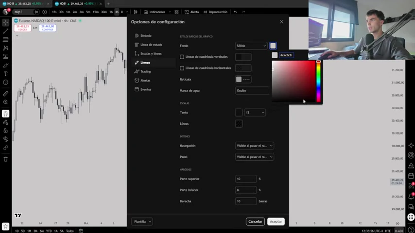
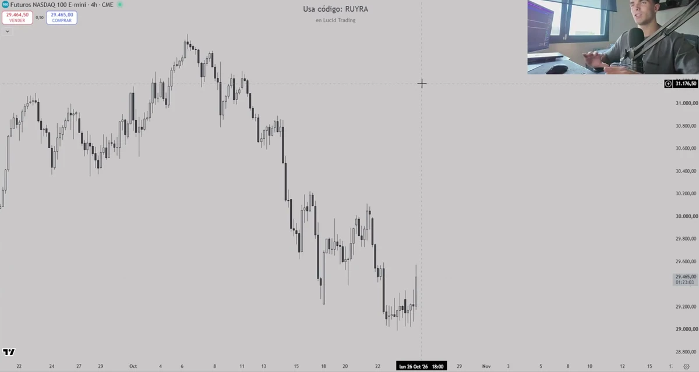
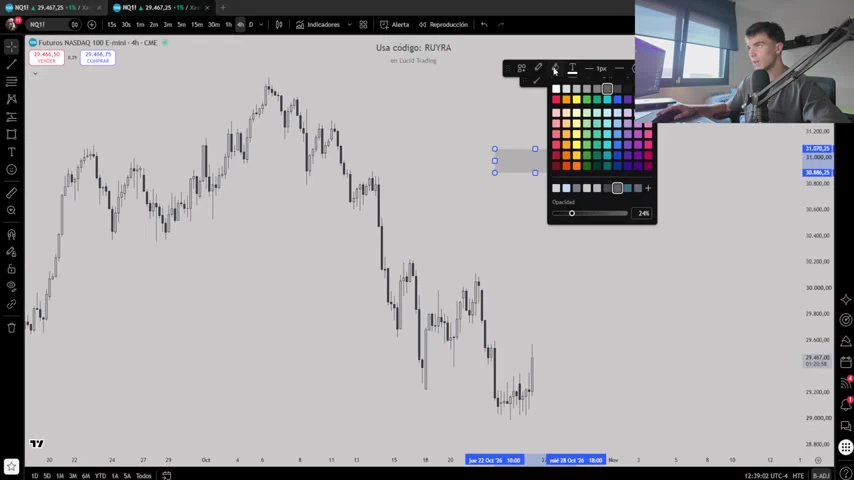
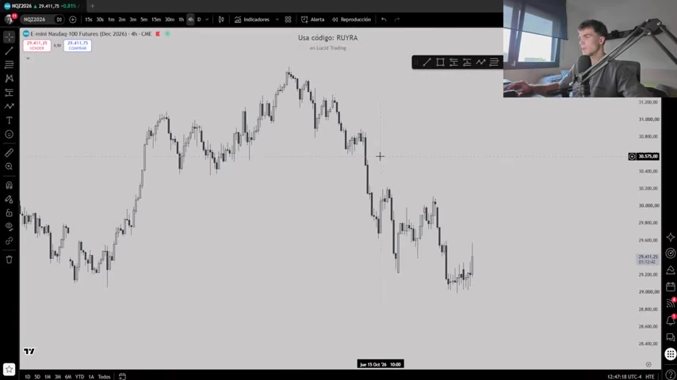

> **Clase 2 de 29** · Duración 22:09 · **Vídeo:** `3aG0N7aHu4s`

> [!note] Apunte del curriculum (cuando se catalogó)
> 
>
> *Se conserva tal cual como historial. El estado actual está arriba.*

## Conceptos que introduce

- [[cuentas-de-fondeo|Cuentas de fondeo]]
- [[rsi|RSI]]
- [[macd|MACD]]
- [[medias-moviles|Medias móviles]]
- [[bandas-de-bollinger|Bandas de Bollinger]]
- [[volumen|Volumen]]
- [[elliott-wave|Elliott Wave]]
- [[armonicos|Armónicos]]
- [[patrones-chartistas-clasicos|Patrones chartistas clásicos]]

## Reglas con fuente en esta clase

- [[no-usar-indicadores-convencionales-ni-volumen|No usar indicadores convencionales ni volumen]]

## Fotogramas

Esta clase tiene **54** fotogramas extraídos; **4** están anotados y verificados para ilustrar conceptos.

### Capturas verificadas de esta clase

**3aG0N7aHu4s** · **03:42** · anotado y verificado

> Ventana 'Opciones de configuración' de TradingView. Fondo del gráfico en color sólido CAC8C8. Se ve el selector de color abierto.

**3aG0N7aHu4s** · **04:44** · anotado y verificado

> Gráfico NQ 4H con velas gris claro y negro, mechas y bordes negros, fondo CAC8C8. Sin volumen ni indicadores.

**3aG0N7aHu4s** · **06:49** · anotado y verificado

> Gráfico NQ 4H con un rectángulo dibujado y el selector de color abierto; opacidad al 24%.

**3aG0N7aHu4s** · **15:04** · anotado y verificado

> Gráfico MNQ 4H limpio, fondo CAC8C8, velas grises/negras, sin indicadores. Se ve el precio y la escala.

---

[← Día 1](./dia-01) · [Índice del bootcamp](./index) · [Día 3 →](./dia-03)
