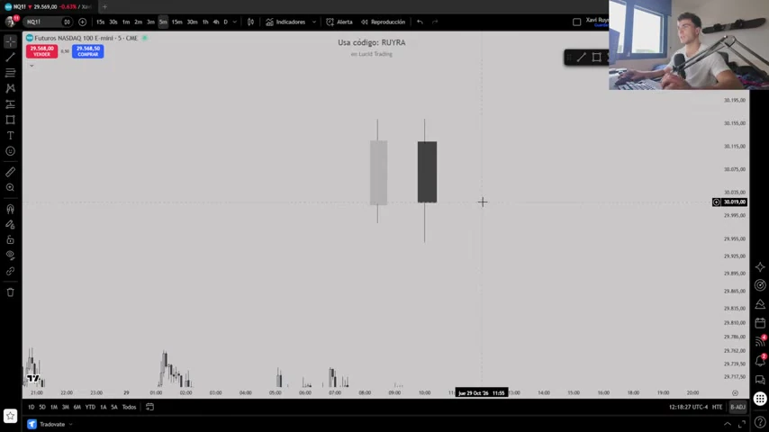
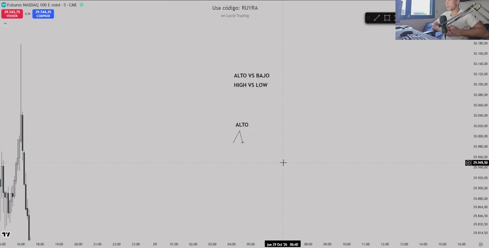
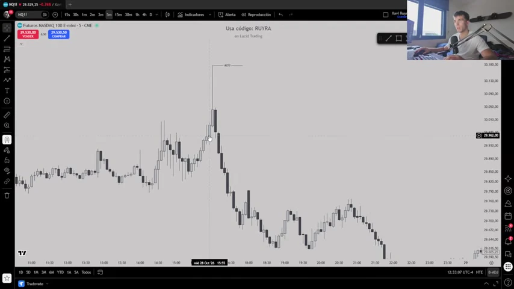
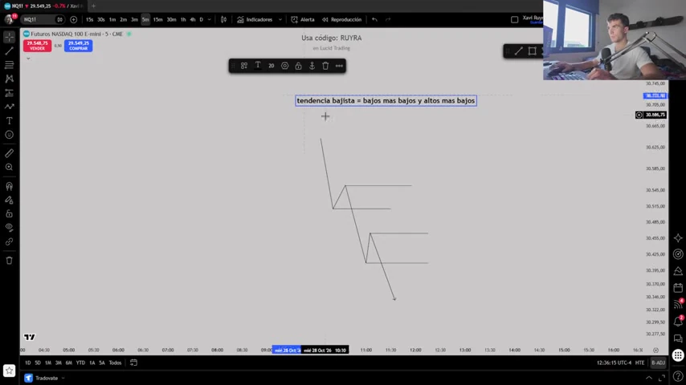

> **Clase 4 de 29** · Duración 21:15 · **Vídeo:** `SuRgJd8ONIc`

> [!note] Apunte del curriculum (cuando se catalogó)
> 
>
> *Se conserva tal cual como historial. El estado actual está arriba.*

## Conceptos que introduce

- [[swing-high-swing-low|Swing High / Swing Low]]

## Reglas con fuente en esta clase

- [[definicion-de-high-low-y-tendencia|Definición de high/low y tendencia]]

## Fotogramas

Esta clase tiene **46** fotogramas extraídos; **4** están anotados y verificados para ilustrar conceptos.

### Capturas verificadas de esta clase

**SuRgJd8ONIc** · **02:07** · anotado y verificado

> Dos velas aisladas sobre fondo limpio: una gris clara y una negra, con mechas y cuerpos visibles.

**SuRgJd8ONIc** · **15:43** · anotado y verificado

> Diapositiva 'ALTO VS BAJO / HIGH VS LOW' con un dibujo de dos velas y la palabra 'ALTO' sobre el máximo.

**SuRgJd8ONIc** · **16:46** · anotado y verificado

> Gráfico NQ 5m con una línea y la etiqueta 'alto' en la mecha superior de una secuencia de velas.

**SuRgJd8ONIc** · **19:55** · anotado y verificado

> Dibujo esquemático de una tendencia bajista con líneas de máximos y mínimos decrecientes. Texto: 'tendencia bajista = bajos más bajos y altos más bajos'.

---

[← Día 3](./dia-03) · [Índice del bootcamp](./index) · [Día 5 →](./dia-05)
