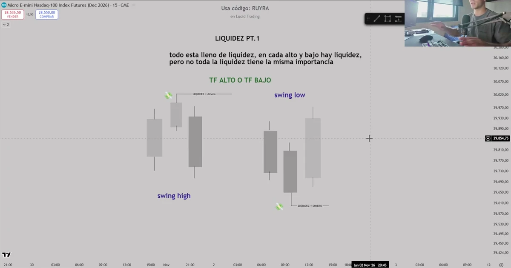
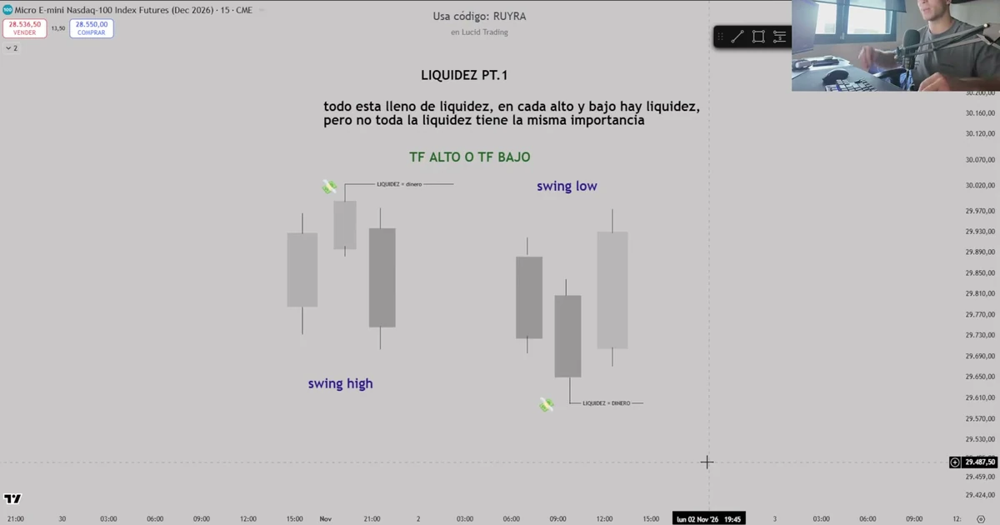
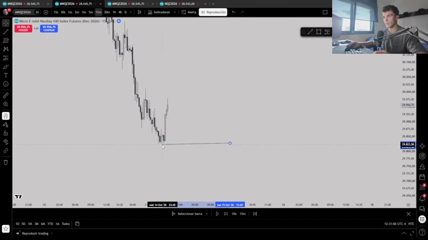
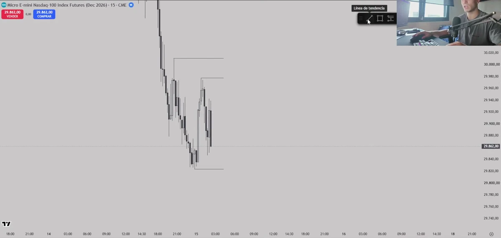
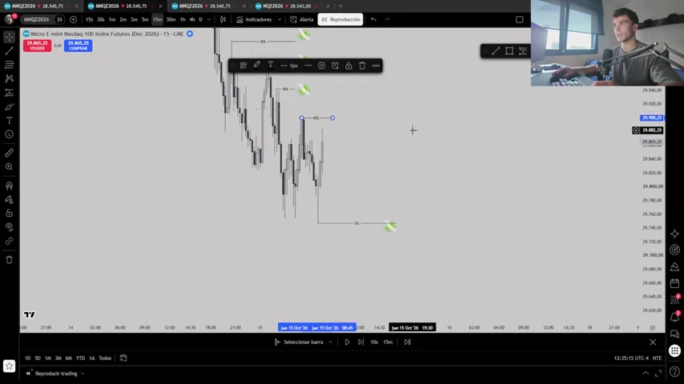
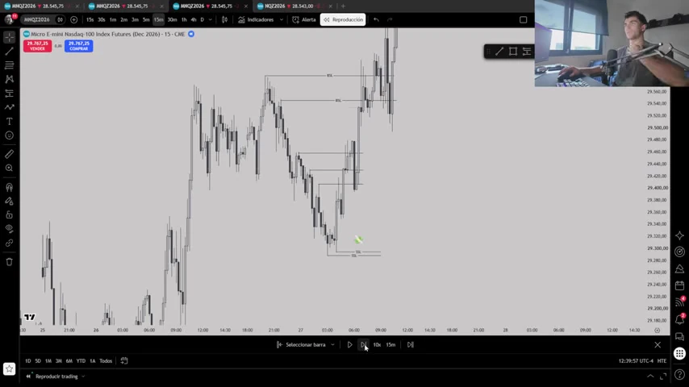
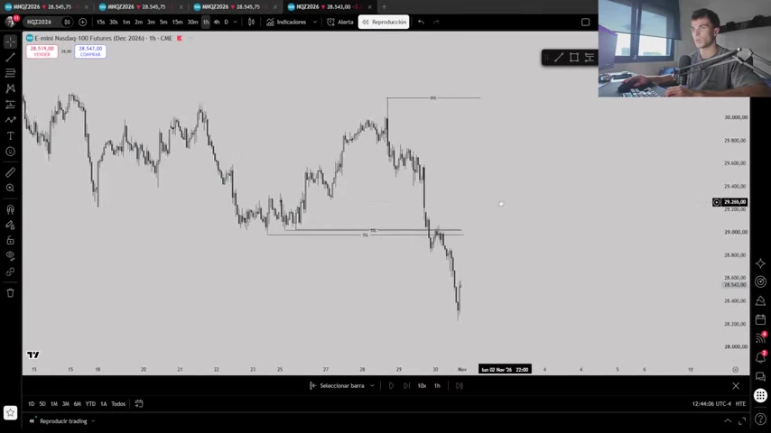

> **Clase 6 de 29** · Duración 21:25 · **Vídeo:** `7HOAf7vHMqU`

> [!note] Apunte del curriculum (cuando se catalogó)
> Liquidez pt2 pendiente.
>
> *Se conserva tal cual como historial. El estado actual está arriba.*

## Conceptos que introduce

- [[liquidez-bsl-ssl|Liquidez (BSL/SSL)]]
- [[swing-high-swing-low|Swing High / Swing Low]]

## Reglas con fuente en esta clase

- [[la-liquidez-de-temporalidades-altas-manda|La liquidez de temporalidades altas manda]]

## Fotogramas

Esta clase tiene **41** fotogramas extraídos; **7** están anotados y verificados para ilustrar conceptos.

### Capturas verificadas de esta clase

**7HOAf7vHMqU** · **01:08** · anotado y verificado

> Diapositiva 'LIQUIDEZ PT.1' superpuesta a un gráfico MNQ 15m. Texto: 'todo está lleno de liquidez, en cada alto y bajo hay liquidez, pero no toda la liquidez tiene la misma importancia'. Anotaciones 'swing high' y 'swing…

**7HOAf7vHMqU** · **02:43** · anotado y verificado

> Gráfico MNQ 15m con un rango amplio. Línea horizontal y etiqueta 'LIQUIDEZ = DINERO' sobre el swing high; otra sobre el swing low. Texto 'TF ALTO O TF BAJO'.

**7HOAf7vHMqU** · **06:21** · anotado y verificado

> Gráfico MNQ 15m tras un tramo bajista. Una línea horizontal marca el mínimo más bajo (mecha) del tramo. No hay indicadores.

**7HOAf7vHMqU** · **08:25** · anotado y verificado

> Gráfico MNQ 15m con varias líneas horizontales cortas en los altos y en los bajos del tramo. Se distinguen BSL en altos sucesivos y SSL en el bajo barrido.

**7HOAf7vHMqU** · **10:30** · anotado y verificado

> Gráfico MNQ 15m con múltiples niveles marcados. Se observa el conteo de 'billetes': varios altos (BSL) frente a un solo bajo (SSL) antes del movimiento.

**7HOAf7vHMqU** · **15:12** · anotado y verificado

> Gráfico MNQ 15m con el tramo completo. Se aprecian los retrocesos (imbalances) entre la SSL barrida y los altos posteriores; el precio asciende hasta la BSL.

**7HOAf7vHMqU** · **19:21** · anotado y verificado

> Gráfico MNQ 1H con líneas en altos y bajos relevantes. Sirve de recap: paso 1 marcar BSL/SSL, paso 2 esperar a que se quite la liquidez.

---

[← Día 5](./dia-05) · [Índice del bootcamp](./index) · [Día 7 →](./dia-07)
