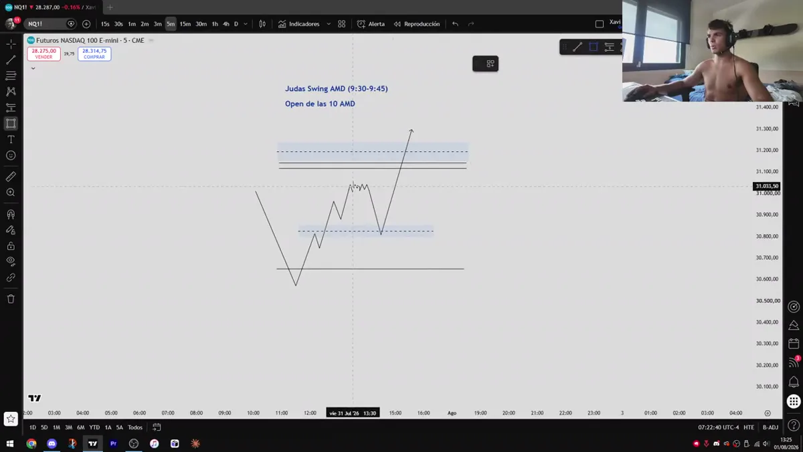

> **Confianza:** explícito · **Estado:** vigente · **Categoría:** CORE

## Definición

Tres fases: acumulación (el precio se prepara), manipulación (movimiento contra el DOL para barrer liquidez) y distribución (movimiento hacia el DOL).

## Cómo identificarlo

Observar la apertura: rango/accumulación, barrido de un high/low y desplazamiento en la dirección del DOL.

## Errores comunes

Confundir la manipulación con la distribución; entrar en la primera vela de 15m.

### Requiere / se combina con

- [[inverse-fair-value-gap-ifvg|Inverse Fair Value Gap (IFVG)]]
- [[po3-power-of-3|PO3 (Power of 3)]]
- [[judas-swing|Judas Swing]]

## Evidencia

- «Paráfrasis: AMD se compone de acumulación, manipulación y distribución; el timing importa.» — `vz4rhIi5Joo` @ 01:37 (explícito)
- «Paráfrasis: acumulación, manipulación y distribución; la manipulación va contra el DOL.» — `oP7enoxXpfI` @ 02:42 (explícito)

## Fragmentos visuales

**La MEJOR estrategia de ICT para FUTUROS (IFVG updated 2026)** (`vz4rhIi5Joo`) · **10:55** · **Confianza:** explícito · anotado
> Diapositiva 'Judas Swing AMD (9:30-9:45)' y 'Open de las 10 AMD' con un zigzag que baja, acumula, manipula y distribuye al alza. Flecha de entrada tras la manipulación.

