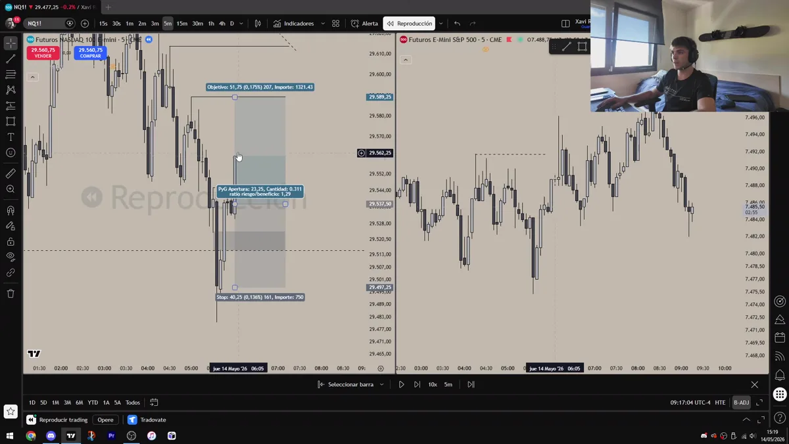
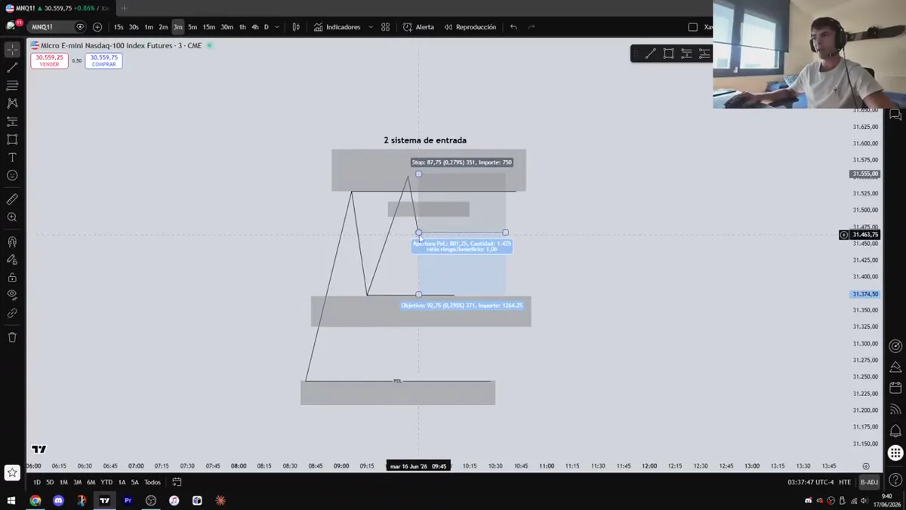

# Break-even estructural

> **Confianza:** explícito · **Estado:** vigente · **Categoría:** SUPPORTING

## Definición

Mover el stop al precio de entrada solo cuando hay un high/low relevante dentro de un FVG/gap de 5 minutos o más, o en una zona de conflicto (FVG de 5m, 15m, 1H o 4H). La versión de mayo de 2026 decía 3m o más.

## Interpretación de Xavi

El BE no es obligatorio. Se pone donde el precio puede reaccionar de verdad; si el low/high es irrelevante, no se pone. Si no hay ningún gap en el camino, se deja correr hasta TP o stop.

## Cómo identificarlo

Buscar el high/low dentro de un FVG/gap de 3m+; comprobar si el SP500 ya quitó su high/low; comprobar si hay zona de conflicto.

## Cuándo se usa

Durante la gestión del trade.

## Condiciones

FVG/gap de 5m+; zona de conflicto (5m/15m/1H/4H); SP500 como confirmación.

## Temporalidades

3m, 5m, 15m, 1H, 4H.

## Aplicación

Mover el stop a BE en el nivel relevante; si no hay nivel, dejar correr.

## Errores comunes

Mover BE a un low/high irrelevante; no moverlo en una zona de conflicto; usarlo para 'salvar' un trade malo.

## Excepciones

Si el SP500 quita su high/low primero, se puede mover BE.

## Notas

Documento 07. Versión mayo 2026 (3m+) conservada como antecedente; vigente desde junio 2026: 5m+ (1C4dgloDQrY 24:08).

## Requiere / se combina con

- [[fair-value-gap-fvg|Fair Value Gap (FVG)]]
- [[smt-smart-money-technique|SMT (Smart Money Technique)]]

## Evidencia

- «Paráfrasis: break-even instantáneo porque la zona era segura; el trade no debía volver al stop.» — `8gs6HOHXMsc` @ 04:10 (observado)
- «Paráfrasis: break-even solo en un high/low dentro de un FVG/gap de 3m o más.» — `5aBdJLMDGJc` @ 06:53 (explícito)
- «Las zonas de conflicto son fair value gaps de 5 minutos, de 15 minutos, de una hora y de 4 horas.» — `1C4dgloDQrY` @ 24:08 (explícito)

## Fragmentos visuales

**Así he ganado +1000$ operando London Session (no podia dejar pasar este trade)** (`8gs6HOHXMsc`) · **04:10** · **Confianza:** explícito · anotado · imagen de contexto, no muestra el concepto
> Herramienta de posición en NQ 5m: entrada, stop, objetivo y ratio riesgo/beneficio 1,29; zona de FVG.

**La SIMPLE ESTRATEGIA con la que he podido RETIRAR +25k$ en PAYOUTS** (`1C4dgloDQrY`) · **24:08** · **Confianza:** explícito · anotado · imagen de contexto, no muestra el concepto
> Esquema '2 sistema de entrada' con varias cajas grises (FVGs) y etiquetas de stop y target; el precio dibujado recorre las zonas. Se ven cifras de stop y objetivo, pero no son legibles con precisión.

