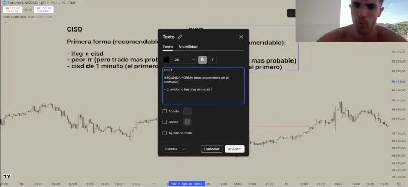

> **Confianza:** explícito · **Estado:** vigente · **Categoría:** SUPPORTING
- **Clase del bootcamp:** [[../bootcamp/dia-13|Día 13 — IFVG]]

## Definición

Cierre de una vela por encima del cuerpo de una vela alcista anterior (CISD alcista) o por debajo del cuerpo de una vela bajista anterior (CISD bajista).

## Interpretación de Xavi

Es casi un break of structure. Se marca el cuerpo, no la mecha; si hay varios candidatos, el cuerpo más alto (alcista) o más bajo (bajista). Es una confluencia secundaria y opcional, no un requisito.

## Cómo identificarlo

Identificar la vela de referencia; marcar el cuerpo; esperar el cierre de la vela que lo atraviesa.

## Cuándo se usa

Cuando no hay IFVG usable y el DOL/Judas está claro; o como confirmación adicional de IFVG.

## Condiciones

1m, el primero; contexto HTF (15m/5m/1H); DOL claro.

## Temporalidades

1m; 15s demasiado ruidoso según él (aunque usa 30s en algunos ejemplos).

## Aplicación

Entrada en el cierre del CISD; stop en el mismo punto estructural; target 1:1 o DOL.

## Errores comunes

Marcar la mecha; entrar antes del cierre; usar CISD sin contexto; usar 15s como base.

## Excepciones

En el recap del 22/10 usa CISD de 30s; es una variante avanzada, no la regla base.

## Notas

Documento 05. Discrepancia 1m vs 30s documentada en 11_PREGUNTAS_ABIERTAS.

## Requiere / se combina con

- [[inverse-fair-value-gap-ifvg|Inverse Fair Value Gap (IFVG)]]
- [[po3-power-of-3|PO3 (Power of 3)]]
- [[displacement|Displacement]]

## Evidencia

- «Paráfrasis: CISD es el cierre por encima del cuerpo de una vela alcista o por debajo del cuerpo de una bajista.» — `_drb5sSmQZE` @ 00:33 (explícito)
- «No voy a explicaros CISD... de cada 100 trades igual lo uso una vez.» — `ICOx4rdFSLg` @ 00:34 (explícito)
- «Paráfrasis: usar el 1m, el primero; el 15s es demasiado ruidoso.» — `_drb5sSmQZE` @ 03:39 (explícito)

## Fragmentos visuales

**Todo lo que necesitas saber sobre este concepto - CISD** (`_drb5sSmQZE`) · **06:45** · **Confianza:** explícito · anotado
> Cuadro de texto sobre el gráfico NQ 1m: 'CISD. Primera forma (recomendable): - ifvg + cisd - peor rr (pero trade más probable) - cisd de 1 minuto (el primero)'. Debajo: 'SEGUNDA FORMA (más experiencia en el mercado): cua…

