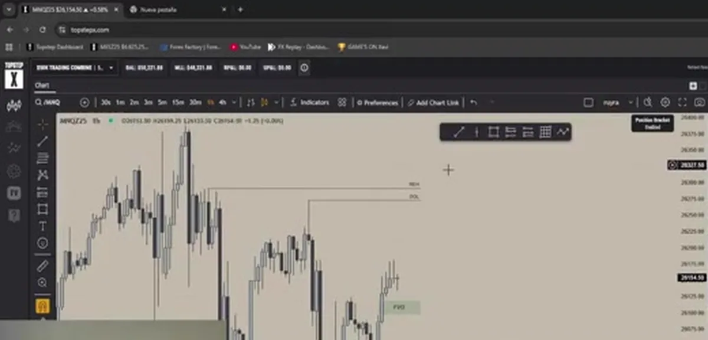
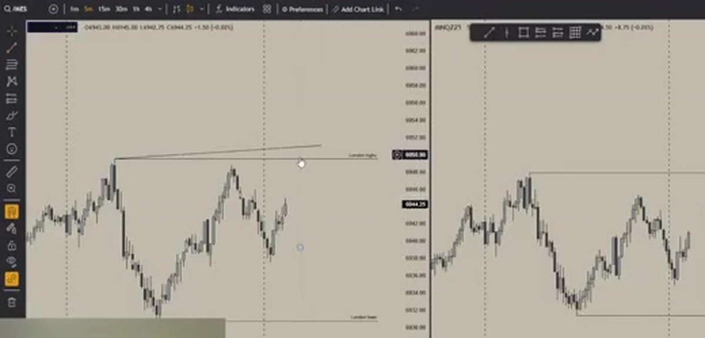
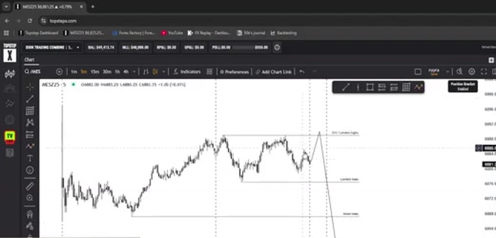

# Daily Bias

> **Confianza:** explícito · **Estado:** vigente · **Categoría:** CORE

## Definición

Dirección que se espera para el día (compras o ventas), construida desde el respeto/inversión de FVG en 4H y 1H.

## Interpretación de Xavi

No es una predicción cerrada: es una condición. 'Este gap de 4H va a ser mi condición; si desplazamos por debajo, ventas'. Es reactivo: cambia si aparece un triple relative equal low o si el correlacionado no confirma.

## Cómo identificarlo

4H primero; 1H después; ver qué FVG se respetan y cuáles se invierten. Si hay duda, esperar la vela de las 10:00.

## Cuándo se usa

Al inicio de la sesión y durante la sesión si cambia la evidencia.

## Condiciones

Tiene que haber un DOL claro. Si el HTF no dice nada, no operar.

## Temporalidades

4H/1H; 15m/5m para ejecución.

## Aplicación

Definir la dirección; buscar PO3 y entradas alineadas; actualizar si el contexto cambia.

## Errores comunes

Fijar el bias y no actualizarlo; operar contra el HTF porque un LTF da señal; sobreanalizar.

## Excepciones

El bias puede cambiar en vivo; la masterclass del 25/09 es el ejemplo.

## Notas

Documento 03.

## Requiere / se combina con

- [[fair-value-gap-fvg|Fair Value Gap (FVG)]]
- [[draw-on-liquidity-dol|Draw on Liquidity (DOL)]]
- [[equilibrium-premium-descuento|Equilibrium (premium/descuento)]]
- [[smt-smart-money-technique|SMT (Smart Money Technique)]]

## Evidencia

- «Paráfrasis: el high relevante de 1H se marca como DOL; el FVG queda como zona de referencia.» — `TxoOh3MFdO0` @ 00:30 (observado)
- «Paráfrasis: SMT con London high/low; escenario de venta en NQ hacia sell-side.» — `FjOU3YeVW4E` @ 00:50 (observado)
- «Paráfrasis: en 2025 el bias se construía con highs/lows de Londres y Asia, NWOG y SMT; proyección al Asian low.» — `DbWKWSy5ycY` @ 01:10 (observado)
- «Paráfrasis: sweep del London high y proyección al London low / low de 1H.» — `rhWKoE6H5LU` @ 01:17 (observado)
- «Paráfrasis: SMT entre ES y NQ y objetivo en el FVG sin filar.» — `gNsZXb8j1So` @ 01:30 (observado)
- «Soy súper reactivo.» — `Imr4TPKUD-c` @ 04:51 (explícito)

## Fragmentos visuales

**BIAS 03/11/25** (`TxoOh3MFdO0`) · **00:30** · **Confianza:** explícito · anotado
> Gráfico MNQZ25 1H. Líneas 'high' y 'DOL' sobre dos highs; zona verde 'FVG' por debajo del precio.

**BIAS 29/10** (`FjOU3YeVW4E`) · **00:50** · **Confianza:** explícito · anotado
> Pantalla dividida ES (izquierda) y NQ (derecha), 5m. 'London high' y 'London low' en ES; estructura comparable en NQ.

**BIAS 27/10/25** (`DbWKWSy5ycY`) · **01:10** · **Confianza:** explícito · anotado
> Gráfico MESZ25 5m. Líneas 'EQ - London high', 'London low' y 'Asian low'. Proyección descendente desde el sweep del London high hasta el Asian low.

