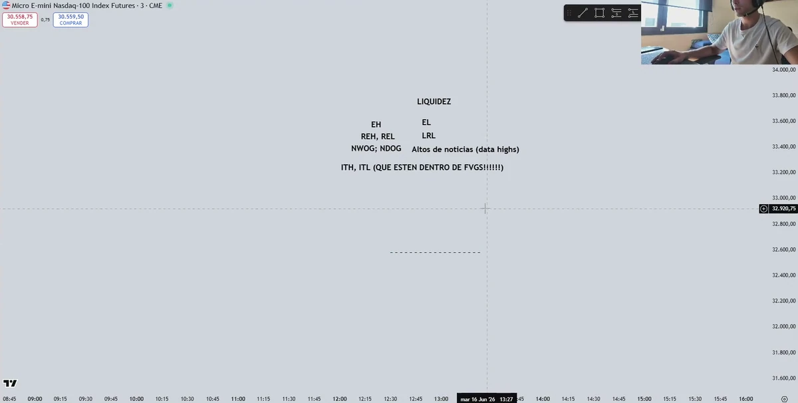

# Data Highs / Lows

> **Confianza:** explícito · **Estado:** vigente · **Categoría:** CONTEXTUAL

## Definición

Highs/lows que deja una noticia (CPI, FOMC, etc.) y que se usan como referencia de liquidez.

## Interpretación de Xavi

En días de noticia, esos niveles pueden ser target o zona de manipulación.

## Cómo identificarlo

Marcar el high/low de la vela de la noticia.

## Cuándo se usa

Días de CPI/FOMC y noticias relevantes.

## Condiciones

Noticia identificada.

## Temporalidades

1m/5m/15m.

## Aplicación

Usarlos como target o como zona donde esperar manipulación.

## Errores comunes

Ignorarlos; operar la noticia sin contexto.

## Excepciones

No está desarrollado en detalle.

## Notas

Documento 04. Uso poco desarrollado.

## Requiere / se combina con

- [[draw-on-liquidity-dol|Draw on Liquidity (DOL)]]
- [[po3-power-of-3|PO3 (Power of 3)]]

## Evidencia

- «Paráfrasis: en días de CPI/FOMC se marcan los highs/lows de la noticia.» — `oP7enoxXpfI` @ 27:15 (explícito)

## Fragmentos visuales

**La SIMPLE ESTRATEGIA con la que he podido RETIRAR +25k$ en PAYOUTS** (`1C4dgloDQrY`) · **45:51** · **Confianza:** explícito · anotado
> La misma diapositiva 'LIQUIDEZ' completa: EH, REH, REL, EL, LRL, NWOG, NDOG, altos de noticias (data highs) e 'ITH, ITL (QUE ESTÉN DENTRO DE FVGS!!!!)'.

