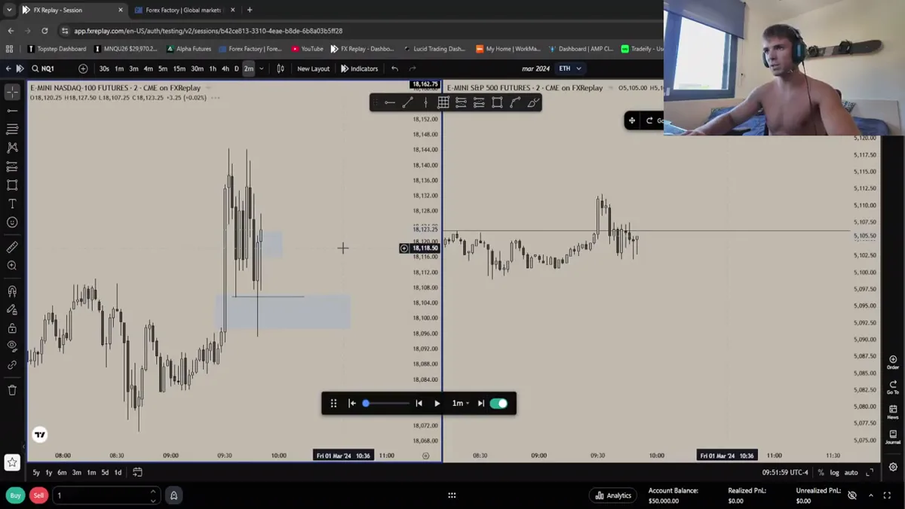
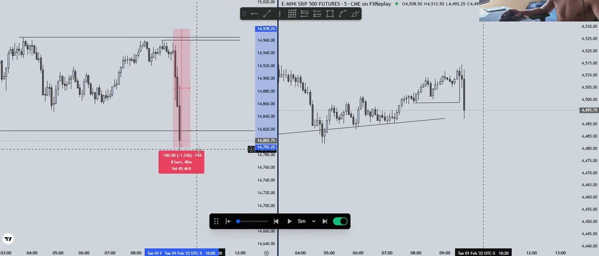

# Displacement

> **Confianza:** explícito · **Estado:** vigente · **Categoría:** SUPPORTING

## Definición

Movimiento impulsivo del precio que deja un FVG y muestra intención.

## Interpretación de Xavi

Puede confirmar la distribución y servir como trigger si no hay un IFVG limpio.

## Cómo identificarlo

Velas de impulso que rompen estructura y dejan un gap.

## Cuándo se usa

En la entrada del PO3.

## Condiciones

Contexto y DOL.

## Temporalidades

1m/5m.

## Aplicación

Confirmar la entrada; a veces sustituye al IFVG.

## Errores comunes

Confundir cualquier vela grande con displacement.

## Excepciones

No está desarrollado como concepto independiente.

## Notas

Documento 04.

## Requiere / se combina con

- [[fair-value-gap-fvg|Fair Value Gap (FVG)]]
- [[inverse-fair-value-gap-ifvg|Inverse Fair Value Gap (IFVG)]]
- [[po3-power-of-3|PO3 (Power of 3)]]
- [[cisd-change-in-state-of-delivery|CISD (Change in State of Delivery)]]

## Evidencia

- «Paráfrasis: el desplazamiento y la inversión de FVG confirman la entrada.» — `oP7enoxXpfI` @ 10:24 (explícito)

## Fragmentos visuales

**APLICANDO la MEJOR ESTRATEGIA de ICT (actualizada 2026)** (`PzkT4SC47Jo`) · **03:39** · **Confianza:** explícito · anotado
> FX Replay, pantalla dividida NQ (izquierda) y ES (derecha), temporalidad 1H, 27-29 de febrero de 2024. El NQ viene de un desplazamiento bajista y un rebote; Xavi está fijando el alto dentro del FVG de 1H para plantear lo…

**APLICANDO la MEJOR ESTRATEGIA de ICT (actualizada 2026)** (`PzkT4SC47Jo`) · **05:40** · **Confianza:** explícito · anotado
> NQ y ES en 1 minuto, viernes 1 de marzo de 2024, 10:36 en el replay. Se ve una zona sombreada azul (gap/FVG) y el desplazamiento de la sesión. No se ve el ticket de la entrada de 9:49-9:50.

**Sesión de backtesting APLICANDO mi ESTRATEGIA de IFVG** (`mCMpxc0NaN4`) · **05:45** · **Confianza:** explícito · anotado
> Pantalla dividida NQ/ES en 5m; un rectángulo rojo marca el desplazamiento bajista previo a la apertura de Nueva York.

