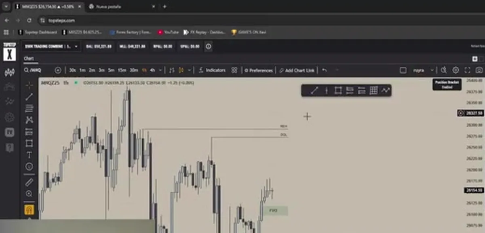

> **Confianza:** explícito · **Estado:** vigente · **Categoría:** CORE
- **Clase del bootcamp:** [[../bootcamp/dia-21|Día 21 — Daily bias + DOL]]

## Definición

Nivel de liquidez hacia el que se espera que vaya el precio: un high/low relevante dentro de un FVG/PD array.

## Cómo identificarlo

Abrir 4H; ver si respeta FVG alcistas e invalida bajistas (o al revés); localizar el high/low relevante dentro de un FVG de 4H/1H. Si hay dos DOL o ninguno, no operar.

## Errores comunes

Usar un high/low que no está en ninguna zona; operar con DOL en ambos lados; forzar cuando el DOL ya se cumplió; sobreanalizar cada gap.

### Requiere / se combina con

- [[fair-value-gap-fvg|Fair Value Gap (FVG)]]
- [[po3-power-of-3|PO3 (Power of 3)]]
- [[equilibrium-premium-descuento|Equilibrium (premium/descuento)]]
- [[smt-smart-money-technique|SMT (Smart Money Technique)]]

## Evidencia

- «Paráfrasis: el high marcado como DOL es el objetivo; el FVG queda por debajo.» — `TxoOh3MFdO0` @ 00:30 (observado)
- «Paráfrasis: el Asian low es el target de la proyección.» — `DbWKWSy5ycY` @ 01:10 (observado)
- «Paráfrasis: el FVG sin filar arriba es el TP final.» — `gNsZXb8j1So` @ 01:30 (observado)
- «Días en los que podemos tener un DOL aquí y un DOL aquí en los dos lados... son días en los que simplemente no puedes hacer nada.» — `zcT31zmE5Uc` @ 01:33 (explícito)
- «Cuando yo os diga 'este es el DOL', es que yo quiero que el precio llegue hasta ahí.» — `MQyNBiw-QVo` @ 02:39 (explícito)
- «El DOL puede ser un equal high, un data high o low resistance liquidity alineada con un key level.» — `MQyNBiw-QVo` @ 03:10 (explícito)
- «Paráfrasis: el high dentro de un FVG de 15 minutos es el TP.» — `8gs6HOHXMsc` @ 05:47 (explícito)
- «Necesito un high relevante de cuatro horas y de una hora que esté dentro de un fair value gap... un PD array viene a ser un fair value gap.» — `F3anMVV-VlI` @ 08:48 (explícito)

## Fragmentos visuales

**BIAS 03/11/25** (`TxoOh3MFdO0`) · **00:30** · **Confianza:** explícito · anotado
> Gráfico MNQZ25 1H. Líneas 'high' y 'DOL' sobre dos highs; zona verde 'FVG' por debajo del precio.

