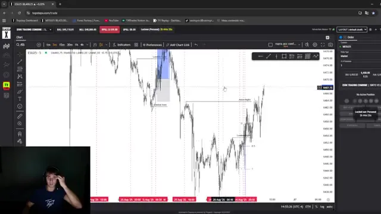
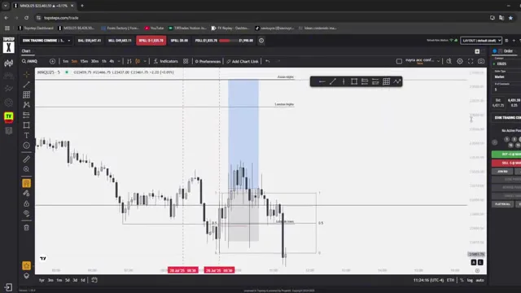
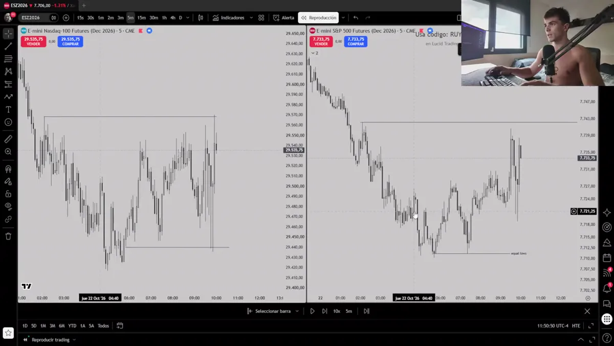

# Ego (psicología)

> **Confianza:** explícito · **Estado:** vigente · **Categoría:** CONTEXTUAL

## Definición

Exceso de confianza que aparece tras una racha de victorias y lleva a creer que el resultado está garantizado; puede relajar el filtro de entrada, subir el riesgo o replicar cuentas en exceso.

## Interpretación de Xavi

El ego sube después de ganar. Una racha de un mes no es una muestra significativa: el win rate tiende a volver al del backtesting, así que hay que esperar más stops. Su respuesta es mantener el riesgo, no replicar cuentas en exceso y no encadenar rupturas de reglas tras un error humano.

## Cómo identificarlo

Racha de wins seguida de confianza excesiva; sensación de que todo va a verde; entrar en trades que se saben malos porque 'se gana rápido'; querer replicar cuentas o subir el riesgo para retirar más.

## Cuándo se usa

Después de una racha ganadora, especialmente si se acerca un objetivo de payout.

## Condiciones

La confianza sube por resultados recientes y se confunde con una ventaja sostenida.

## Temporalidades

No aplica.

## Aplicación

Recordar que la muestra de un mes no es significativa; esperar más stops; no subir el riesgo; no replicar cuentas en exceso; si se comete un error humano, no encadenar rupturas de reglas y cerrar el día.

## Errores comunes

Creer que la racha es permanente; bajar el filtro porque 'todo sale bien'; doblar el riesgo para llegar al payout; replicar todas las cuentas; gamblear para recuperar el primer día rojo.

## Excepciones

Ninguna documentada.

## Notas

Bootcamp Día 20. Definición 00:33–01:06; racha de 23 TP 01:06–01:38; muestra y win rate 01:38–03:10; caso personal 03:10–04:13; mantener riesgo 04:13–04:45; calendario y día rojo 05:16–06:49; no replicar cuentas 07:21–08:23; cadena de rupturas 08:23–09:56.

## Requiere / se combina con

- [[gambling-vs-trading-psicologia|Gambling vs trading (psicología)]]
- [[revenge-trading-psicologia|Revenge Trading (psicología)]]
- [[fomo-psicologia|FOMO (psicología)]]

## Evidencia

- «También hay gente que entra en una racha de victorias, entra en una muy buena racha y lo que pasa es que su confianza se boostea, su ego sube un montón.» — `ygJya0srm8g` @ 00:33 (explícito)
- «Hubo un mes donde tuve una racha de 23 take profit seguidos en un mes... casi operar cada día y ganar cada día.» — `ygJya0srm8g` @ 01:06 (explícito)
- «Si durante un mes tienes un 100% de win rate, estadísticamente a la larga... esa estadística lo que va a hacer es bajar de un 100% de win rate que estás en ese mes a un 70%.» — `ygJya0srm8g` @ 02:09 (explícito)
- «Yo vi el trade y no pensé ni que era malo. O sea, yo sabía que era malo, pero como venía de ganar dije: entro aquí, gano rápido y ya está... mi ego estaba muy por las nubes.» — `ygJya0srm8g` @ 03:42 (explícito)
- «Cuando estéis en una racha positiva, disfrutarla... pero tienes que hacer que eso no te afecte a la psicología.» — `ygJya0srm8g` @ 07:21 (explícito)

## Fragmentos visuales

**Así he perdido 450$ en dos días operando el SP500 (trade recap)** (`579RkuLzgPQ`) · **00:18** · **Confianza:** explícito · anotado
> MESZ25 5m. 'London highs', 'Asian highs' y zona FVG; panel 'Locked out'.

**TRADE RECAP NQ 28/07/25 (-1.019$) - TOPSTEP** (`p6wC7iWh_Ps`) · **02:15** · **Confianza:** explícito · anotado
> NQ1! 5m. Etiquetas 'London highs' y 'London lows'; rectángulo gris (FVG) bajo la caja azul; línea de equilibrio marcada '0.5' a la derecha; el precio cae a través de la zona gris.

**Trade Recap +15.000$ operando NQ (true manipulation + po3 explicado)** (`OdljBowQurk`) · **04:41** · **Confianza:** explícito · anotado
> Pantalla dividida NQ/ES en 5m. Rectángulos grises marcan los gaps de 4H y 5m; el precio los atraviesa y luego invierte.

