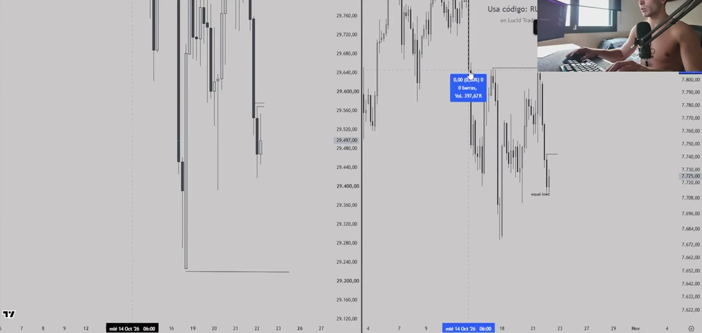
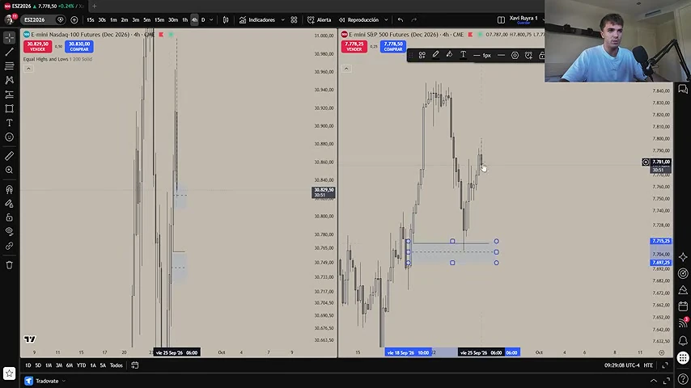

> **Confianza:** explícito · **Estado:** vigente · **Categoría:** SUPPORTING
- **Clase del bootcamp:** [[../bootcamp/dia-11|Día 11 — Liquidez pt2]]

## Definición

Dos o más highs/lows al mismo nivel o muy cercanos; generan una bolsa de liquidez.

## Interpretación de Xavi

Son liquidez pendiente y pueden cambiar el DOL. Los relative equal highs/lows son una versión menos exacta.

## Cómo identificarlo

Marcar highs/lows repetidos; comprobar si están dentro de una zona.

## Cuándo se usa

Como target, como excepción al DOL y como contexto para el stacking.

## Condiciones

Contexto HTF; no operar contra ellos sin razón.

## Temporalidades

15m/1H/4H.

## Aplicación

Esperar el sweep; usarlos como target.

## Errores comunes

Shortear una subida vertical con equal lows; ignorarlos como liquidez.

## Excepciones

Pueden ser relative (no exactos).

## Notas

Documento 03.

## Requiere / se combina con

- [[draw-on-liquidity-dol|Draw on Liquidity (DOL)]]
- [[po3-power-of-3|PO3 (Power of 3)]]
- [[low-resistance-liquidity-lrl|Low Resistance Liquidity (LRL)]]

## Evidencia

- «Paráfrasis: los equal highs/lows son una excepción al DOL limpio.» — `Urrb1b2kBso` @ 02:06 (explícito)
- «Dos mechas que estén a la misma altura, tienen que estar exactamente a la misma altura y relative equal high... son altos relativamente iguales.» — `OtYATAfCfRA` @ 03:40 (explícito)
- «Si nosotros tuviésemos esto, no cuenta... ya hemos cogido la liquidez, ya hemos cogido ese cash.» — `OtYATAfCfRA` @ 04:10 (explícito)
- «Esto lo vamos a mirar desde la temporalidad de 5 minutos a 15 minutos... y de hecho es incluso mejor... de cinco al diario.» — `OtYATAfCfRA` @ 04:42 (explícito)

## Fragmentos visuales

**Trade Recap +15.000$ operando NQ (true manipulation + po3 explicado)** (`OdljBowQurk`) · **01:36** · **Confianza:** explícito · anotado
> Pantalla dividida: NQ a la izquierda y ES a la derecha, ambos en diario. En ES se marca 'equal highs' y una caja azul de posición.

**Como REACCIONAR al mercado ADAPTANDO TU BIAS (masterclass)** (`Imr4TPKUD-c`) · **02:37** · **Confianza:** explícito · anotado
> Pantalla dividida NQ/ES en 4H. En NQ se ve una caja azul de FVG y el indicador Equal Highs and Lows; en ES, otra caja azul y el mismo indicador. El precio está reaccionando a la zona.

