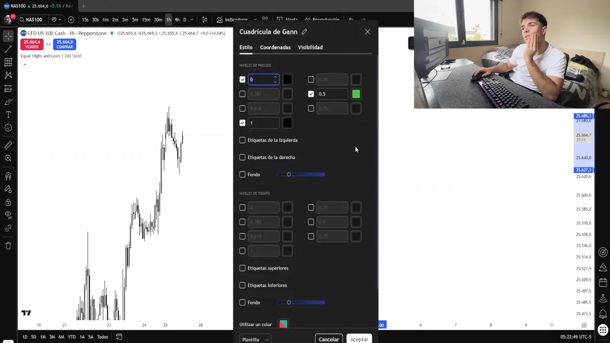
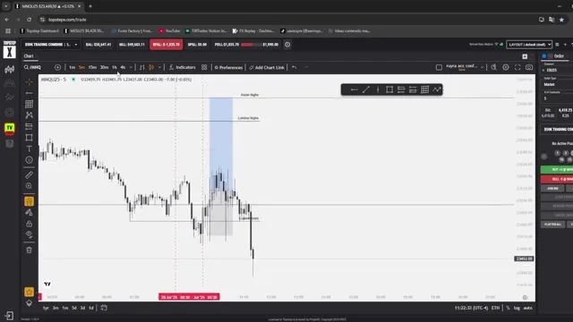

# Equilibrium (premium/descuento)

> **Confianza:** explícito · **Estado:** vigente · **Categoría:** CORE

## Definición

Línea media de un rango que separa la zona premium (cara, arriba) de la zona de descuento (barata, abajo). En el bootcamp se dibuja con el retroceso de Fibonacci (0.5); la cuadrícula de Gann es la versión histórica de 2025.

## Interpretación de Xavi

El precio busca la zona operativa para llenar órdenes a mejor precio. En cortos, el premium es donde el precio no necesita subir más. El FVG debe estar alineado con la línea 0.5 y la confirmación es el IFVG.

## Cómo identificarlo

Compras: anclar swing low→swing high; la mitad inferior es descuento (zona gris). Ventas: anclar swing high→swing low; la mitad superior es premium (zona gris). El 0.5 es el equilibrium. En 5m, rango creado; si duda, dos rangos.

## Cuándo se usa

Para filtrar entradas y definir el plus setup.

## Condiciones

El precio debe tocar equilibrium; si no, normalmente no hay trade. Combinar con FVG alineado, liquidez e IFVG.

## Temporalidades

5m (rango creado); HTF pendiente de confirmar con Fibonacci (la regla del rango completo es de la versión Gann).

## Aplicación

Esperar que el precio llegue a la zona gris, reaccione y dar entrada con IFVG.

## Errores comunes

Comprar en premium o vender en descuento; entrar antes de que el precio toque equilibrium; usar el rango completo en 5m; no esperar la reacción ni el IFVG; entrar por un FVG que no está en la zona; dibujar equilibrium en lateralización.

## Excepciones

'El precio no siempre tiene que estar en el descuento'; la regla es no operar en la zona contraria, no exigir que todo el movimiento esté en descuento.

## Notas

Documento 06. Día 19 (2026-11-13): Fibonacci vigente; Gann histórico; etiqueta premium corregida; IFVG como confirmación.

## Requiere / se combina con

- [[fair-value-gap-fvg|Fair Value Gap (FVG)]]
- [[inverse-fair-value-gap-ifvg|Inverse Fair Value Gap (IFVG)]]
- [[draw-on-liquidity-dol|Draw on Liquidity (DOL)]]
- [[po3-power-of-3|PO3 (Power of 3)]]
- [[key-levels|Key Levels]]

## Evidencia

- «La herramienta que os dije el primer día de todas, es el retroceso de Fibonacci... os vais a configuración y me copiáis estos settings.» — `56ES-W1d0xw` @ 00:35 (explícito)
- «El equilibrium sirve exactamente para saber en qué zona es más probable que el precio reaccione.» — `56ES-W1d0xw` @ 01:06 (explícito)
- «Es muy importante saber exactamente en qué zonas vamos a estar mirando esto y sobre todo esto lo vamos a combinar con todo lo que hemos visto, especialmente swing high y swing lows y FVGs.» — `56ES-W1d0xw` @ 01:37 (explícito)
- «El precio tiene que estar en el descuento... nunca vamos a comprar ni vender estando en la zona premium.» — `AacVWPPYK8Y` @ 01:38 (explícito)
- «Configuración mostrada: cuadrícula de Gann con niveles de precio 0, 0.5 y 1; niveles de tiempo desactivados.» — `AacVWPPYK8Y` @ 03:06 (observado)
- «En los cortos esto implica que el precio no tiene necesidad de ir más arriba... porque ya he encontrado un buen precio.» — `56ES-W1d0xw` @ 04:19 (explícito)
- «Ese 50%, ese 0,5 significa la zona 50%... siempre tienes el premium arriba y el discount abajo.» — `56ES-W1d0xw` @ 05:21 (explícito)
- «Cuando buscamos compras, buscamos siempre la zona de descuento, la zona de color gris. Y cuando buscamos ventas, buscamos siempre la zona premium, que es la zona de color gris.» — `56ES-W1d0xw` @ 06:22 (explícito)

## Fragmentos visuales

**COMO uso EQUILIBRIUM para TODAS mis ENTRIES** (`AacVWPPYK8Y`) · **03:06** · **Confianza:** explícito · anotado
> Configuración de la Cuadrícula de Gann en TradingView: pestaña Estilo.

**TRADE RECAP NQ 28/07/25 (-1.019$) - TOPSTEP** (`p6wC7iWh_Ps`) · **00:32** · **Confianza:** explícito · anotado
> NQ1! en 5 minutos. Caja azul vertical sobre la sesión de Londres. Etiquetas 'Asian highs' y 'London highs' en la parte superior y 'London lows' en la inferior. Banda horizontal azul claro y rectángulo gris (zona/FVG) baj…

**Trade Recap 27/01/2026 (A+ day)** (`hisdBc9mGQ4`) · **00:39** · **Confianza:** explícito · anotado
> NQ 5m. FVG/equilibrium y entrada marcada; contexto A+.

