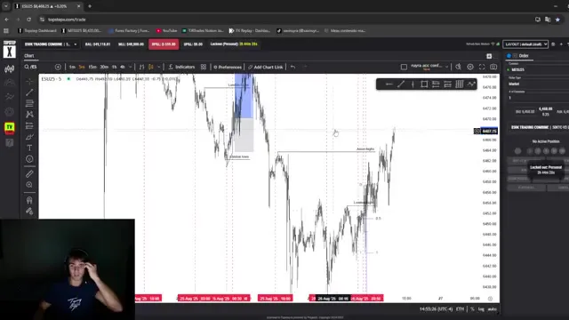
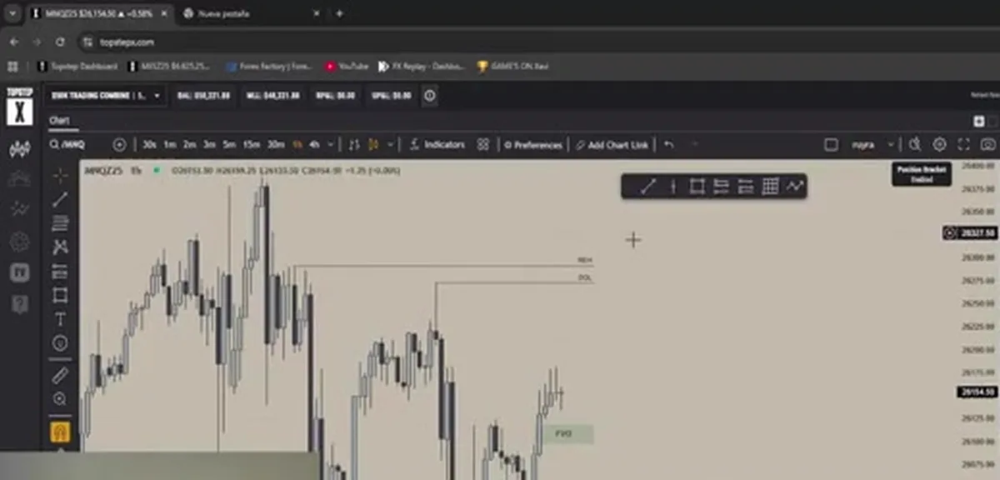
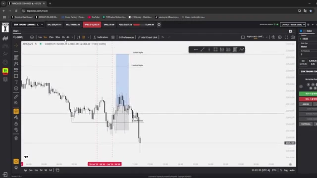

> **Confianza:** explícito · **Estado:** vigente · **Categoría:** CORE
- **Clases del bootcamp:** [[../bootcamp/dia-08|Día 8]] · [[../bootcamp/dia-29|Día 29]]

## Definición

Secuencia de tres velas consecutivas en la que las mechas de la primera y la tercera no se tocan; el espacio entre ambas es el FVG. La vela del medio es la referencia.

## Cómo identificarlo

Tres velas; mecha de vela 1 y mecha de vela 3 no se tocan. El color de las tres velas es irrelevante. El tamaño es irrelevante: un FVG pequeño vale igual que uno grande. Si no hay espacio entre mechas, no hay FVG.

## Errores comunes

Creer que las tres velas deben ser del mismo color; descartar FVG pequeños; invertir con una mecha en lugar de un cierre de cuerpo; mirar solo HTF y no los gaps de 5m/15m.

### Requiere / se combina con

- [[inverse-fair-value-gap-ifvg|Inverse Fair Value Gap (IFVG)]]
- [[draw-on-liquidity-dol|Draw on Liquidity (DOL)]]
- [[po3-power-of-3|PO3 (Power of 3)]]
- [[equilibrium-premium-descuento|Equilibrium (premium/descuento)]]
- [[nwog-new-week-opening-gap|NWOG (New Week Opening Gap)]]

## Evidencia

- «Paráfrasis: tres velas, no importa el color; el FVG actúa como un imán; el tamaño no importa.» — `1McPSXSSR48` @ 00:31 (explícito)
- «Paráfrasis: el FVG se forma con tres velas; el color, el orden y el tamaño son irrelevantes, y el gap es el espacio entre las mechas de la primera y la tercera.» — `1McPSXSSR48` @ 00:32 (explícito)
- «Paráfrasis: el FVG actúa como imán: el precio suele volver a la zona y continuar hacia la liquidez del lado correspondiente.» — `1McPSXSSR48` @ 00:32 (explícito)
- «Paráfrasis: tres velas; las mechas de la primera y la tercera no se tocan; el espacio entre ellas es el FVG.» — `u-fG6bYvK7k` @ 00:32 (explícito)
- «Paráfrasis: el color y el tamaño de las tres velas son irrelevantes.» — `u-fG6bYvK7k` @ 02:31 (explícito)
- «No es obligatorio, no 200% de porcentaje de acierto; con una buena dirección, la mayoría de las veces funciona.» — `1McPSXSSR48` @ 05:58 (explícito)
- «Paráfrasis: el FVG no es una certeza; no acierta el 100% de las veces ni es obligatorio que el precio reaccione.» — `1McPSXSSR48` @ 05:59 (explícito)
- «Si el FVG es de 15 minutos, nos tenemos que esperar a que cierre la vela de 15 minutos para saber si se ha invertido o no.» — `nxlZJ6abOYA` @ 06:15 (explícito)

## Fragmentos visuales

**Así he perdido 450$ en dos días operando el SP500 (trade recap)** (`579RkuLzgPQ`) · **00:18** · **Confianza:** explícito · anotado
> MESZ25 5m. 'London highs', 'Asian highs' y zona FVG; panel 'Locked out'.

**BIAS 03/11/25** (`TxoOh3MFdO0`) · **00:30** · **Confianza:** explícito · anotado
> Gráfico MNQZ25 1H. Líneas 'high' y 'DOL' sobre dos highs; zona verde 'FVG' por debajo del precio.

**TRADE RECAP NQ 28/07/25 (-1.019$) - TOPSTEP** (`p6wC7iWh_Ps`) · **00:32** · **Confianza:** explícito · anotado
> NQ1! en 5 minutos. Caja azul vertical sobre la sesión de Londres. Etiquetas 'Asian highs' y 'London highs' en la parte superior y 'London lows' en la inferior. Banda horizontal azul claro y rectángulo gris (zona/FVG) baj…

