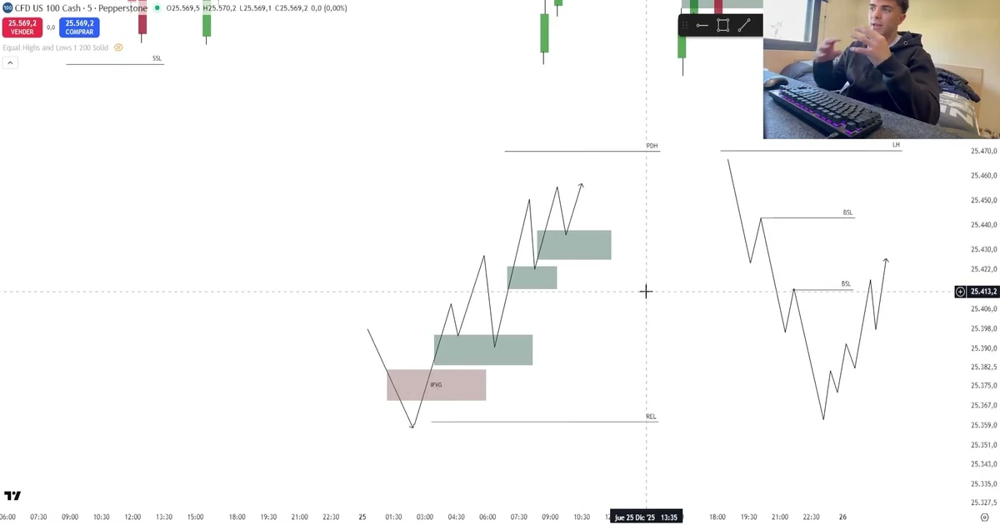

> **Confianza:** explícito · **Estado:** vigente · **Categoría:** SUPPORTING

## Definición

Liquidez interna: highs/lows dentro del rango. Liquidez externa: highs/lows fuera del rango.

## Cómo identificarlo

Marcar el rango; los extremos son externos; los highs/lows interiores son internos.

## Errores comunes

Confundir ambos; targetear solo external y no ver los internos.

### Requiere / se combina con

- [[fair-value-gap-fvg|Fair Value Gap (FVG)]]
- [[draw-on-liquidity-dol|Draw on Liquidity (DOL)]]

## Evidencia

- «Paráfrasis: liquidez interna = highs/lows dentro del rango; externa = fuera.» — `u-fG6bYvK7k` @ 13:00 (explícito)

## Fragmentos visuales

**SIN este CONCEPTO NUNCA serás RENTABLE | Como usar FVG's** (`u-fG6bYvK7k`) · **13:32** · **Confianza:** explícito · anotado
> Esquema de liquidez interna y externa: cajas de FVG, líneas de liquidez (BSL/SSL) y flechas de recorrido. Texto 'internal liquidity'.

