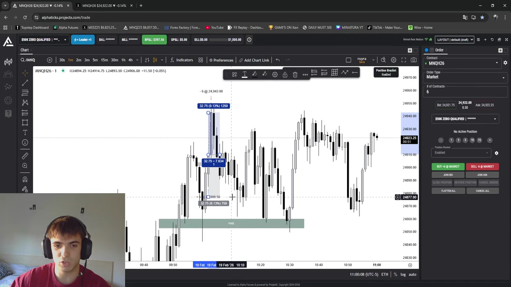
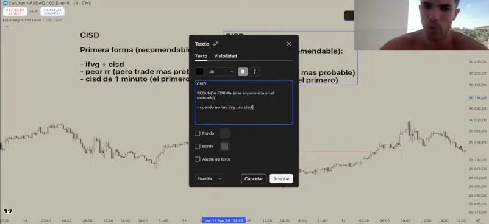

# Inverse Fair Value Gap (IFVG)

> **Confianza:** explícito · **Estado:** vigente · **Categoría:** CORE

## Definición

FVG que ha sido invertido: una vela cierra con el cuerpo completamente al otro lado del FVG.

## Interpretación de Xavi

Cuando un FVG se invierte, el precio empieza a respetar los FVG de la dirección contraria. El IFVG es el trigger de entrada principal.

## Cómo identificarlo

Esperar el cierre de la vela. El cuerpo debe atravesar el FVG por completo; una mecha que entra y vuelve a cerrar dentro no es inversión, es respeto.

## Cuándo se usa

Entradas en Judas Swing y en el open de las 10:00.

## Condiciones

Cierre de cuerpo; alineación con el DOL; sweep previo; contexto HTF.

## Temporalidades

1m/3m/5m para entrada; 15m/1H/4H para contexto.

## Aplicación

Tras la manipulación, entrar en el primer IFVG alineado con la distribución. Stop al otro lado del swing/manipulación.

## Errores comunes

Entrar antes del cierre; confundir una mecha con una inversión; usar un IFVG contra el HTF; saltarse el contexto por el trigger.

## Excepciones

Puede usarse IFVG de 1m si el DOL es muy claro; en otros casos se espera al de 3m/5m.

## Notas

Documento 02.

## Requiere / se combina con

- [[fair-value-gap-fvg|Fair Value Gap (FVG)]]
- [[po3-power-of-3|PO3 (Power of 3)]]
- [[cisd-change-in-state-of-delivery|CISD (Change in State of Delivery)]]
- [[equilibrium-premium-descuento|Equilibrium (premium/descuento)]]

## Evidencia

- «Yo nunca, nunca, nunca voy a darle al botón de comprar o vender sin un inverse fair value gap.» — `ICOx4rdFSLg` @ 03:21 (explícito)
- «Paráfrasis: en el Judas Swing busca el primer IFVG alineado con el DOL; no siempre toma el IFVG de mayor temporalidad.» — `vz4rhIi5Joo` @ 04:11 (explícito)
- «Paráfrasis: tras una caída fuerte, no suele tomar el primer IFVG; prefiere que falle y esperar un segundo que confirme la dirección.» — `mCMpxc0NaN4` @ 05:45 (explícito)
- «Paráfrasis: la inversión exige que el cuerpo cierre completamente al otro lado; una mecha no invierte.» — `u-fG6bYvK7k` @ 06:11 (explícito)
- «Solo vamos a estar tomando inverse fair value gaps de entre 30 segundos a 5 minutos... nunca vamos a estar pillando un inverse fair value gap de 15 minutos.» — `ICOx4rdFSLg` @ 10:45 (explícito)
- «Paráfrasis: un IFVG es un FVG que se ha invertido.» — `1McPSXSSR48` @ 16:34 (explícito)
- «Paráfrasis: IFVG (inverse fair value gap) es un FVG que se ha invertido.» — `1McPSXSSR48` @ 16:34 (explícito)
- «Un inverse fair value gap no puede tardar más de tres velas, tres, cuatro velas en darse.» — `ICOx4rdFSLg` @ 17:41 (explícito)

## Fragmentos visuales

**Trade Recap 19/02/2026 (5 wins seguidas)** (`B3zNsJ9LdVA`) · **01:33** · **Confianza:** explícito · anotado
> NQ 5m. Inverse FVG de 1m y entrada marcada.

**Todo lo que necesitas saber sobre este concepto - CISD** (`_drb5sSmQZE`) · **06:45** · **Confianza:** explícito · anotado
> Cuadro de texto sobre el gráfico NQ 1m: 'CISD. Primera forma (recomendable): - ifvg + cisd - peor rr (pero trade más probable) - cisd de 1 minuto (el primero)'. Debajo: 'SEGUNDA FORMA (más experiencia en el mercado): cua…

