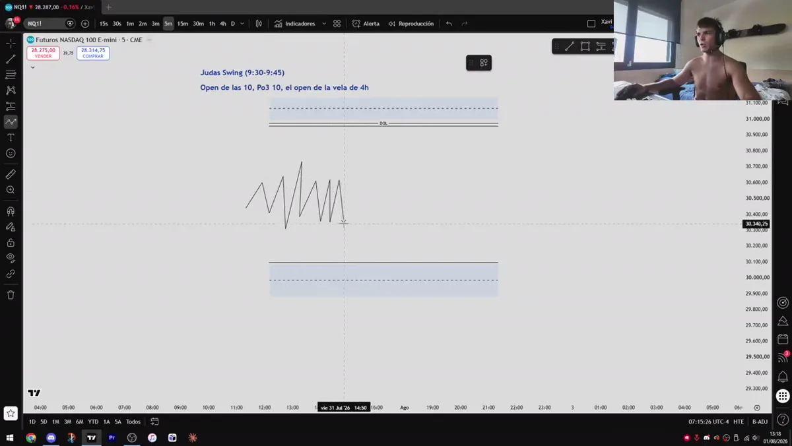
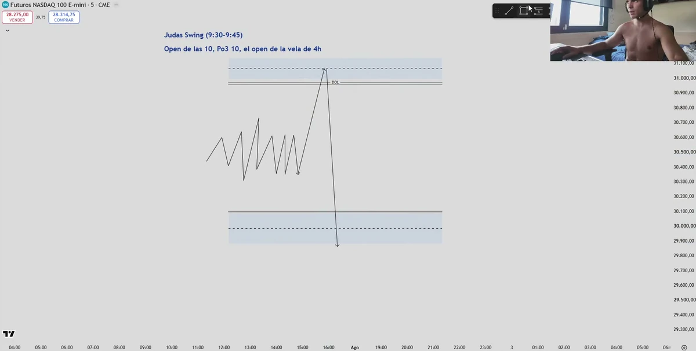

# Judas Swing

> **Confianza:** explícito · **Estado:** vigente · **Categoría:** CORE

## Definición

Primer PO3 del día: acumulación en premarket, manipulación en el market open (9:30) y distribución en la dirección del DOL.

## Interpretación de Xavi

Es el sistema de entrada de la primera hora. Se busca el primer IFVG alineado tras la manipulación.

## Cómo identificarlo

Acumulación antes de las 9:30; velón de manipulación hacia una zona clave; desplazamiento en la dirección del DOL; primer IFVG.

## Cuándo se usa

9:30–9:45, normalmente.

## Condiciones

DOL claro; zona de manipulación (gap/key level); HTF PD array 15m+; alineación con el DOL.

## Temporalidades

3m/5m para el IFVG; 1m si el DOL es muy claro.

## Aplicación

Esperar la manipulación; entrar en el primer IFVG; stop al otro lado del swing; target 1:1 o DOL.

## Errores comunes

Entrar en la manipulación; entrar 9:41–9:44; usar un IFVG contra el HTF; no esperar el cierre.

## Excepciones

Puede saltarse el 3m e ir al 1m si el DOL y el price action son claros.

## Notas

Documento 05.

## Requiere / se combina con

- [[inverse-fair-value-gap-ifvg|Inverse Fair Value Gap (IFVG)]]
- [[po3-power-of-3|PO3 (Power of 3)]]
- [[amd-acumulacion-manipulacion-distribucion|AMD (Acumulación, Manipulación, Distribución)]]
- [[cisd-change-in-state-of-delivery|CISD (Change in State of Delivery)]]

## Evidencia

- «El Judas Swing se trata de esperar la acumulación, una manipulación hacia arriba y pillar la distribución.» — `vz4rhIi5Joo` @ 02:09 (explícito)
- «El Judas Swing se trata de esperar la acumulación, una manipulación hacia arriba y pillar la distribución.» — `vz4rhIi5Joo` @ 03:40 (explícito)
- «Paráfrasis: contempla un Judas Swing con IFVG de 3 minutos, pero no toma esa entrada porque el SP500 aún no estaba en la zona que buscaba.» — `F3anMVV-VlI` @ 04:10 (explícito)

## Fragmentos visuales

**La MEJOR estrategia de ICT para FUTUROS (IFVG updated 2026)** (`vz4rhIi5Joo`) · **03:40** · **Confianza:** explícito · anotado
> Diapositiva sobre NQ 5m: 'Judas Swing (9:30-9:45)' y 'Open de las 10, PO3 10, el open de la vela de 4h'. Esquema de zigzag con dos zonas azules, una arriba y otra abajo.

**La MEJOR estrategia de ICT para FUTUROS (IFVG updated 2026)** (`vz4rhIi5Joo`) · **04:11** · **Confianza:** explícito · anotado
> Captura del esquema de precio durante la explicación del Judas Swing, con zonas horizontales. No hay un rótulo legible que identifique el primer IFVG ni su cierre.

