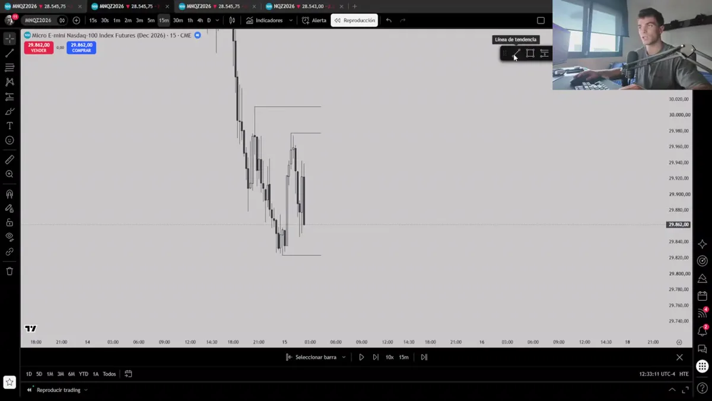
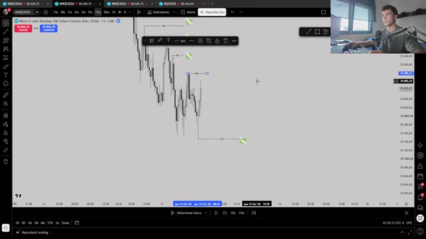

> **Confianza:** explícito · **Estado:** vigente · **Categoría:** CORE
- **Clase del bootcamp:** [[../bootcamp/dia-06|Día 6 — Liquidez pt1]]

## Definición

Dinero en forma de órdenes/stops que descansa por encima de los máximos (BSL) y por debajo de los mínimos (SSL).

## Interpretación de Xavi

La liquidez es dinero. El precio se mueve buscando liquidez a través de imbalances. Las instituciones necesitan esa liquidez para llenar órdenes; los stops del retail son parte de esa liquidez.

## Cómo identificarlo

Marcar swing highs y swing lows. BSL = máximos; SSL = mínimos. El color de la vela no importa. Si la temporalidad actual no forma un low válido, bajar de temporalidad para marcar la mecha extrema.

## Cuándo se usa

Siempre: es la base del DOL, del PO3 y de los targets.

## Condiciones

La liquidez de 15m, 1H y 4H pesa más que la de 1m/5m porque contiene más órdenes. No es una regla mecánica de contar highs/lows.

## Temporalidades

15m, 1H, 4H (más peso); 1m/5m/30s para ejecución.

## Aplicación

Identificar el lado con más liquidez pendiente; esperar el sweep; buscar distribución hacia el lado opuesto.

## Errores comunes

Contar todos los highs/lows como si valieran lo mismo; ignorar la liquidez de temporalidades altas; operar contra el lado con más liquidez.

## Excepciones

No siempre el precio va al lado con más liquidez; hace falta contexto. 'Sí que es más importante, pero no siempre'.

## Notas

Bootcamp Día 6. Liquidez pt2 pendiente de publicación.

## Requiere / se combina con

- [[fair-value-gap-fvg|Fair Value Gap (FVG)]]
- [[draw-on-liquidity-dol|Draw on Liquidity (DOL)]]
- [[po3-power-of-3|PO3 (Power of 3)]]
- [[equilibrium-premium-descuento|Equilibrium (premium/descuento)]]
- [[nwog-new-week-opening-gap|NWOG (New Week Opening Gap)]]
- [[ndog-new-day-opening-gap|NDOG (New Day Opening Gap)]]
- [[equal-highs-equal-lows|Equal Highs / Equal Lows]]
- [[low-resistance-liquidity-lrl|Low Resistance Liquidity (LRL)]]

## Evidencia

- «La liquidez es dinero.» — `7HOAf7vHMqU` @ 01:08 (explícito)
- «Paráfrasis: cada high y cada low tiene liquidez; las temporalidades altas mandan.» — `7HOAf7vHMqU` @ 02:11 (explícito)
- «Paráfrasis: BSL son los highs; SSL son los lows.» — `7HOAf7vHMqU` @ 07:23 (explícito)

## Fragmentos visuales

**Bootcamp Día 6: Liquidez pt1** (`7HOAf7vHMqU`) · **08:25** · **Confianza:** explícito · anotado
> Gráfico MNQ 15m con varias líneas horizontales cortas en los altos y en los bajos del tramo. Se distinguen BSL en altos sucesivos y SSL en el bajo barrido.

**Bootcamp Día 6: Liquidez pt1** (`7HOAf7vHMqU`) · **10:30** · **Confianza:** explícito · anotado
> Gráfico MNQ 15m con múltiples niveles marcados. Se observa el conteo de 'billetes': varios altos (BSL) frente a un solo bajo (SSL) antes del movimiento.

