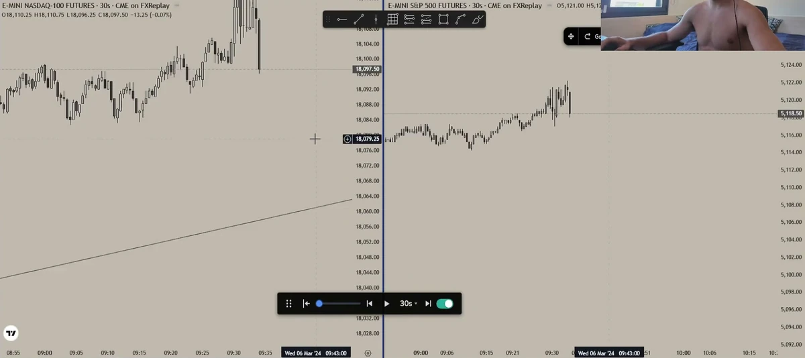
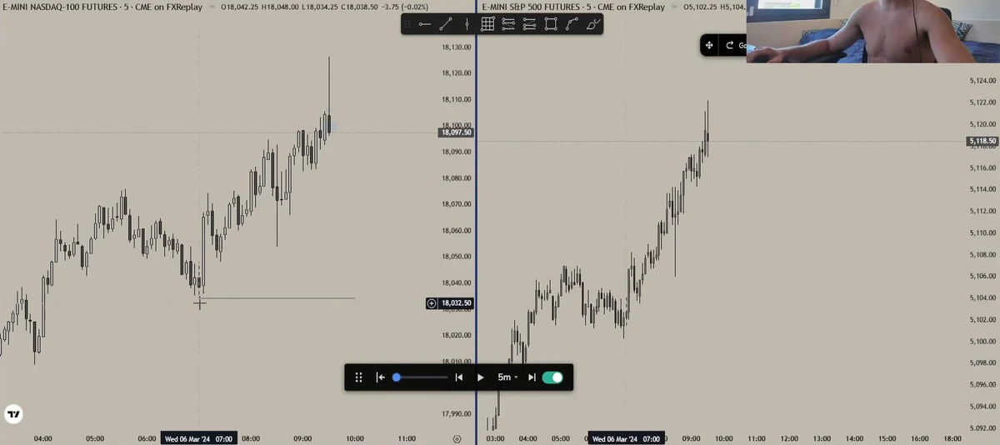

# Low Resistance Liquidity (LRL)

> **Confianza:** explícito · **Estado:** vigente · **Categoría:** SUPPORTING

## Definición

Muchos highs que están juntos o lows que no se han llegado a quitar nunca entre ellos.

## Interpretación de Xavi

Es un objetivo: hay muchísima liquidez hacia un lado y el precio tiene que ir a tocarla para decidir si sigue o gira. Cuanta más LRL, más peso tiene como draw.

## Cómo identificarlo

Varios highs próximos entre sí, o varios lows que nunca se han quitado entre ellos; comprobar que no hay un FVG relevante que los proteja.

## Cuándo se usa

Antes de validar un PO3 o un short tras una subida.

## Condiciones

Estructura clara; no vertical.

## Temporalidades

15m/5m/1m.

## Aplicación

Confirmar que hay espacio para la distribución.

## Errores comunes

Shortear una subida vertical sin LRL; confundir LRL con cualquier zona.

## Excepciones

No está definido con precisión; se reconoce por estructura.

## Notas

Definición explícita en PzkT4SC47Jo (2026-08-30, 12:28–12:58). Antes solo estaba inferida.

## Requiere / se combina con

- [[po3-power-of-3|PO3 (Power of 3)]]
- [[equal-highs-equal-lows|Equal Highs / Equal Lows]]

## Evidencia

- «Paráfrasis: muchos highs juntos; LRL; la bajada lenta crea low resistance liquidity.» — `8gs6HOHXMsc` @ 03:40 (observado)
- «Paráfrasis: la LRL es una excepción que puede cambiar el DOL.» — `Urrb1b2kBso` @ 09:24 (explícito)
- «¿Qué es low resistance liquidity? Muchos highs que están juntos o lows que no se han llegado a quitar nunca entre ellos.» — `PzkT4SC47Jo` @ 12:28 (explícito)
- «Tenemos muchísima liquidez hacia abajo y en caso de querer subir, tenemos que sí o sí tocar este objetivo.» — `PzkT4SC47Jo` @ 12:58 (explícito)
- «La joya de la corona, para mí es el que uso más... es para mí el mejor.» — `OtYATAfCfRA` @ 14:31 (explícito)
- «Normalmente en bajas temporalidades de uno a cinco minutos... puede haber low resistance liquidity en una hora... tiene más importancia.» — `OtYATAfCfRA` @ 15:36 (explícito)

## Fragmentos visuales

**APLICANDO la MEJOR ESTRATEGIA de ICT (actualizada 2026)** (`PzkT4SC47Jo`) · **12:28** · **Confianza:** explícito · anotado
> NQ y ES en 30 segundos, miércoles 6 de marzo de 2024, 09:43. Xavi explica la low resistance liquidity mirando el gráfico de 30s; se ven los últimos mínimos y la reacción del precio.

**APLICANDO la MEJOR ESTRATEGIA de ICT (actualizada 2026)** (`PzkT4SC47Jo`) · **12:58** · **Confianza:** explícito · anotado
> NQ y ES en 5 minutos, miércoles 6 de marzo de 2024, 07:05 en el replay. Se ven los máximos previos y el recorrido desde los mínimos que Xavi identifica como LRL.

**La SIMPLE ESTRATEGIA con la que he podido RETIRAR +25k$ en PAYOUTS** (`1C4dgloDQrY`) · **34:27** · **Confianza:** explícito · anotado
> Esquema del tercer modelo: una caja gris grande (FVG), un recorrido que barre un mínimo marcado como 'low resistance liquidity' y sube hasta un objetivo. El título no es visible en este fotograma.

