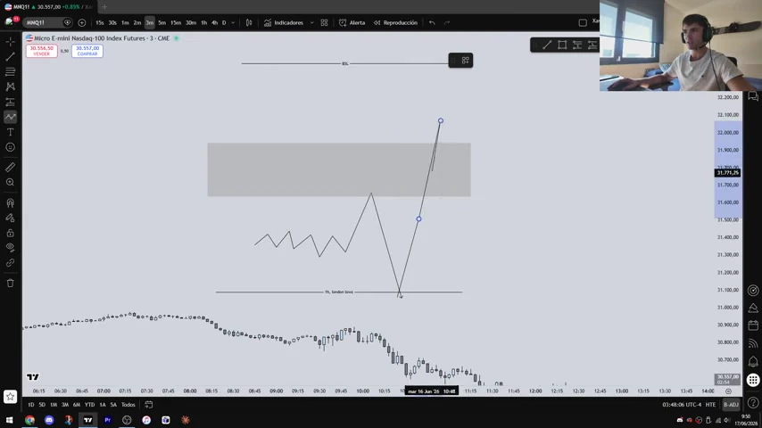
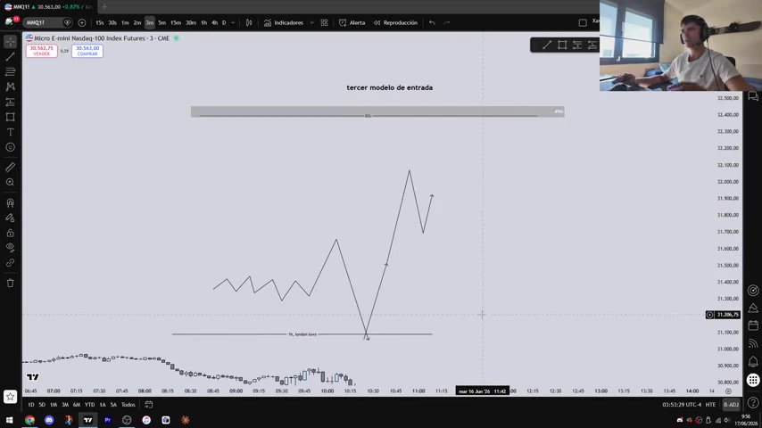

> **Confianza:** explícito · **Estado:** vigente · **Categoría:** SUPPORTING
- **Clase del bootcamp:** [[../bootcamp/dia-11|Día 11 — Liquidez pt2]]

## Definición

Muchos highs que están juntos o lows que no se han llegado a quitar nunca entre ellos.

## Cómo identificarlo

Varios highs próximos entre sí, o varios lows que nunca se han quitado entre ellos; comprobar que no hay un FVG relevante que los proteja.

## Errores comunes

Shortear una subida vertical sin LRL; confundir LRL con cualquier zona.

### Requiere / se combina con

- [[po3-power-of-3|PO3 (Power of 3)]]
- [[equal-highs-equal-lows|Equal Highs / Equal Lows]]

## Evidencia

- «Paráfrasis: muchos highs juntos; LRL; la bajada lenta crea low resistance liquidity.» — `8gs6HOHXMsc` @ 03:40 (observado)
- «Paráfrasis: la LRL es una excepción que puede cambiar el DOL.» — `Urrb1b2kBso` @ 09:24 (explícito)
- «¿Qué es low resistance liquidity? Muchos highs que están juntos o lows que no se han llegado a quitar nunca entre ellos.» — `PzkT4SC47Jo` @ 12:28 (explícito)
- «Tenemos muchísima liquidez hacia abajo y en caso de querer subir, tenemos que sí o sí tocar este objetivo.» — `PzkT4SC47Jo` @ 12:58 (explícito)
- «La joya de la corona, para mí es el que uso más... es para mí el mejor.» — `OtYATAfCfRA` @ 14:31 (explícito)
- «Normalmente en bajas temporalidades de uno a cinco minutos... puede haber low resistance liquidity en una hora... tiene más importancia.» — `OtYATAfCfRA` @ 15:36 (explícito)

## Fragmentos visuales

**La SIMPLE ESTRATEGIA con la que he podido RETIRAR +25k$ en PAYOUTS** (`1C4dgloDQrY`) · **34:27** · **Confianza:** explícito · anotado
> Esquema del tercer modelo: una caja gris grande (FVG), un recorrido que barre un mínimo marcado como 'low resistance liquidity' y sube hasta un objetivo. El título no es visible en este fotograma.

**La SIMPLE ESTRATEGIA con la que he podido RETIRAR +25k$ en PAYOUTS** (`1C4dgloDQrY`) · **39:50** · **Confianza:** explícito · anotado
> Esquema completo del 'tercer modelo de entrada': caja gris grande (FVG), barrido de 'low resistance liquidity', giro y subida hasta TP. El recorrido está dibujado con línea.

