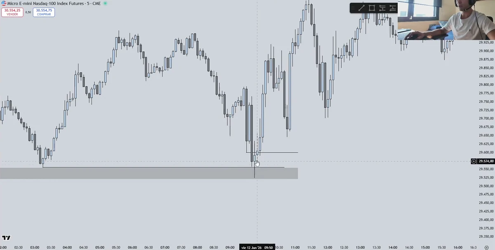

> **Confianza:** explícito · **Estado:** vigente · **Categoría:** CORE
- **Clase del bootcamp:** [[../bootcamp/dia-23|Día 23 — Manipulation legs]]

## Definición

Tramo entre el último swing high/low formado antes de que el precio llegue a la zona de interés y el punto donde se produce la manipulación.

## Cómo identificarlo

Localizar la zona (FVG de 15m, 1H o 4H). Retroceder al último swing high/low previo al toque de la zona. El inicio de la leg es ese swing; el final, el extremo de la manipulación.

## Errores comunes

Coger un IFVG de temporalidad baja cuando dentro de la leg hay uno de temporalidad más alta.

### Requiere / se combina con

- [[fair-value-gap-fvg|Fair Value Gap (FVG)]]
- [[inverse-fair-value-gap-ifvg|Inverse Fair Value Gap (IFVG)]]

## Evidencia

- «La manipulation leg es, básicamente, del swing high al swing low del movimiento que ha quitado el último bajo.» — `JO1xDEW2Lhg` @ 05:44 (explícito)
- «Siempre tenemos que mirar el último alto que se ha creado antes de que el precio llegue a la zona.» — `1C4dgloDQrY` @ 16:51 (explícito)

## Fragmentos visuales

**La SIMPLE ESTRATEGIA con la que he podido RETIRAR +25k$ en PAYOUTS** (`1C4dgloDQrY`) · **16:51** · **Confianza:** explícito · anotado · imagen de contexto, no muestra el concepto
> NQ 5 minutos, sesión del 30 de diciembre, con una zona gris (FVG) y una línea horizontal corta que marca el último alto previo a la entrada en la zona. El precio barre el mínimo y gira.

