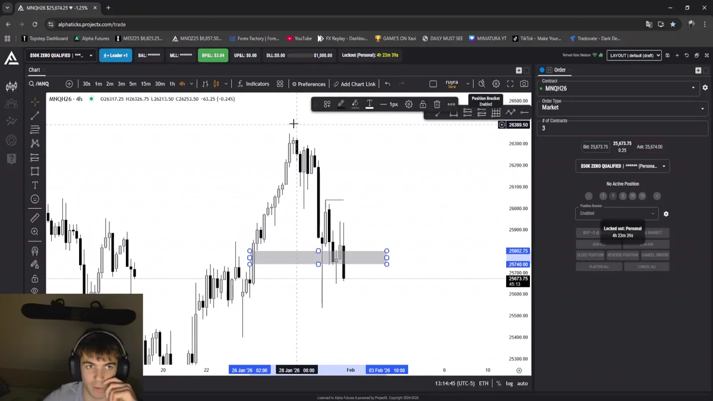
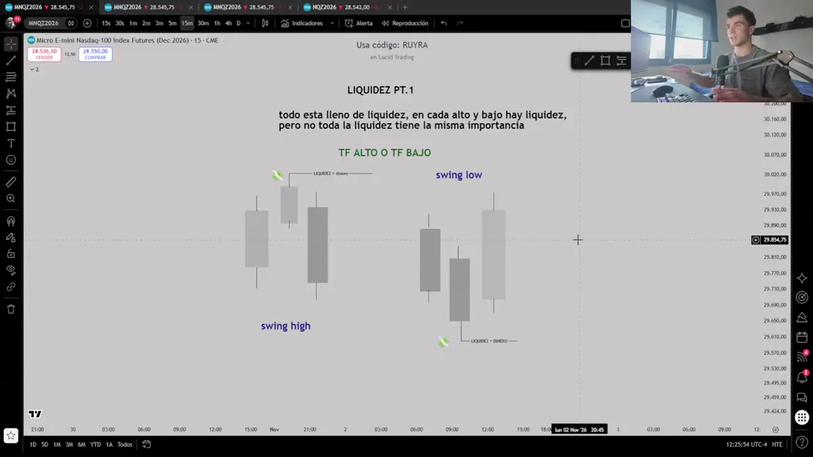
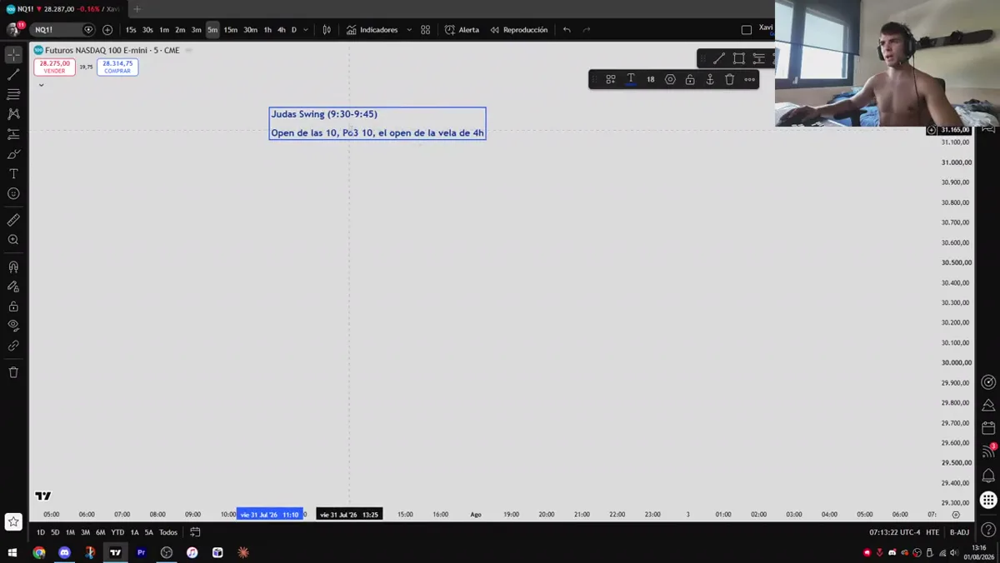

# Medias móviles

> **Confianza:** observado · **Estado:** no usado · **Categoría:** NOT USED

## Definición

Indicadores de media móvil.

## Interpretación de Xavi

No aparecen en su configuración.

## Cómo identificarlo

No aplica.

## Cuándo se usa

No usado.

## Condiciones

No aplica.

## Temporalidades

No aplica.

## Aplicación

No introducirlas.

## Errores comunes

Añadirlas para 'completar'.

## Excepciones

Ninguna.

## Notas

Excluido.

## Evidencia

- «No aparecen en la configuración de TradingView del Día 2.» — `3aG0N7aHu4s` @  (observado)

## Fragmentos visuales

**Trade Recap 30/01/2026** (`yn4aN102x-0`) · **00:39** · **Confianza:** observado · anotado
> NQ 5m. FVG de 4H y contexto de BE.

**Bootcamp Día 6: Liquidez pt1** (`7HOAf7vHMqU`) · **01:08** · **Confianza:** observado · anotado
> Diapositiva 'LIQUIDEZ PT.1' superpuesta a un gráfico MNQ 15m. Texto: 'todo está lleno de liquidez, en cada alto y bajo hay liquidez, pero no toda la liquidez tiene la misma importancia'. Anotaciones 'swing high' y 'swing…

**La MEJOR estrategia de ICT para FUTUROS (IFVG updated 2026)** (`vz4rhIi5Joo`) · **01:37** · **Confianza:** observado · anotado
> Diapositiva con dos esquemas separados: 'Judas Swing (9:30–9:45)' y 'Open de las 10, PO3 10, el open de la vela de 4h'. No muestra las tres fases AMD rotuladas.

