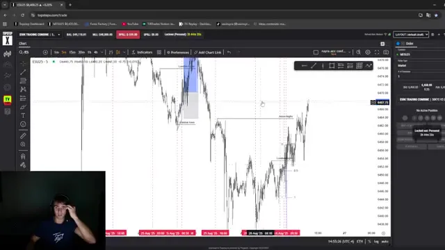
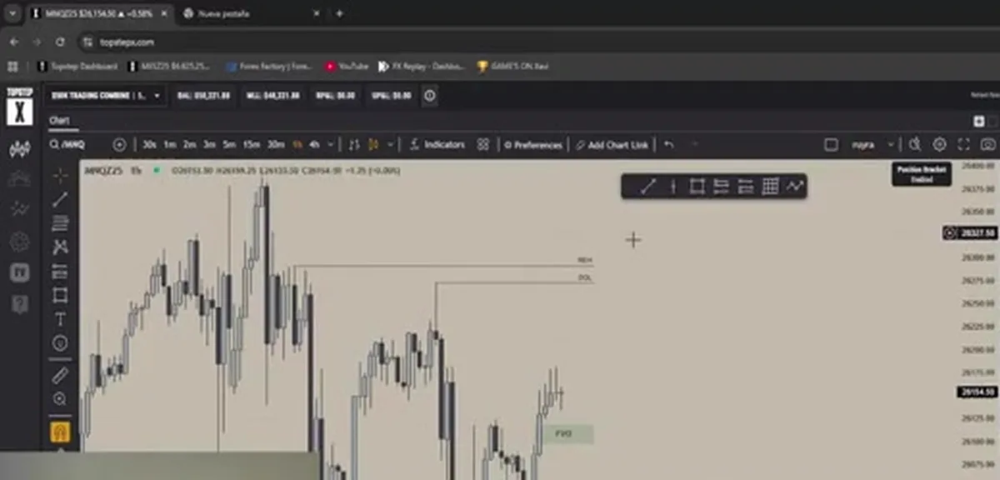

# MNQ / MES

> **Confianza:** explícito · **Estado:** vigente · **Categoría:** CONTEXTUAL

## Definición

Contratos micro de Nasdaq y SP500, con menor riesgo que NQ/ES.

## Interpretación de Xavi

Para principiantes recomienda MNQ y MES; la metodología es la misma, solo cambia el riesgo.

## Cómo identificarlo

Símbolo MNQ en TradingView; MES para el SP500.

## Cuándo se usa

Fase de aprendizaje y bajo riesgo.

## Condiciones

Cuenta pequeña o principiante.

## Temporalidades

Todas.

## Aplicación

Operar la misma estrategia con menos riesgo.

## Errores comunes

Empezar con NQ/ES por el tamaño de la cuenta.

## Excepciones

Cuando el trader ya tiene experiencia y colchón, puede usar NQ.

## Notas

Bootcamp Día 5.

## Evidencia

- «Paráfrasis: para empezar, MNQ y MES; misma metodología, menos riesgo.» — `mBHtx-BfWWg` @ 00:35 (explícito)

## Fragmentos visuales

**Así he perdido 450$ en dos días operando el SP500 (trade recap)** (`579RkuLzgPQ`) · **00:18** · **Confianza:** explícito · anotado
> MESZ25 5m. 'London highs', 'Asian highs' y zona FVG; panel 'Locked out'.

**BIAS 03/11/25** (`TxoOh3MFdO0`) · **00:30** · **Confianza:** explícito · anotado
> Gráfico MNQZ25 1H. Líneas 'high' y 'DOL' sobre dos highs; zona verde 'FVG' por debajo del precio.

**14 take profits seguidos operando el NQ** (`Dfx9SQYerVQ`) · **00:35** · **Confianza:** explícito · anotado
> MNQ 1H del 3 de junio: máximo en 30.786,75 y caída posterior.

