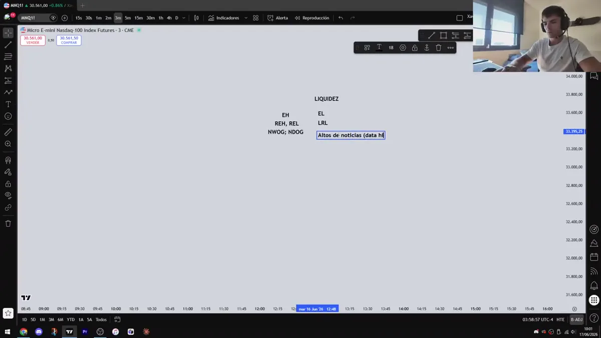
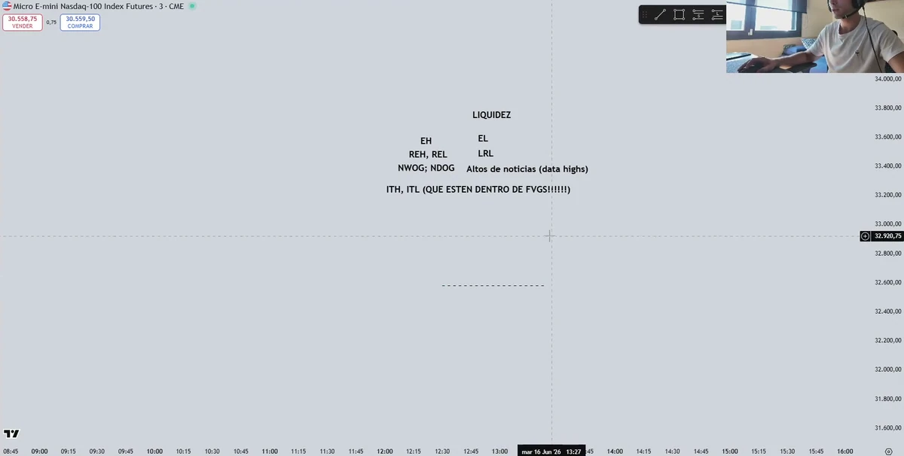

# NDOG (New Day Opening Gap)

> **Confianza:** explícito · **Estado:** vigente · **Categoría:** SUPPORTING

## Definición

Gap de apertura diaria.

## Interpretación de Xavi

Puede actuar como excepción que cambia el DOL.

## Cómo identificarlo

Marcar el gap entre el cierre del día anterior y la apertura del día.

## Cuándo se usa

Como zona de referencia y excepción al DOL.

## Condiciones

Contexto HTF.

## Temporalidades

4H/1H/15m.

## Aplicación

Tenerlo en cuenta si el precio lo respeta o lo usa como target.

## Errores comunes

Ignorarlo en el análisis del DOL.

## Excepciones

No siempre se rellena.

## Notas

Documento 03.

## Requiere / se combina con

- [[fair-value-gap-fvg|Fair Value Gap (FVG)]]
- [[draw-on-liquidity-dol|Draw on Liquidity (DOL)]]

## Evidencia

- «Paráfrasis: el NDOG puede ser una excepción que cambia el DOL.» — `Urrb1b2kBso` @ 02:06 (explícito)

## Fragmentos visuales

**La SIMPLE ESTRATEGIA con la que he podido RETIRAR +25k$ en PAYOUTS** (`1C4dgloDQrY`) · **45:18** · **Confianza:** explícito · anotado
> Diapositiva de texto en TradingView titulada 'LIQUIDEZ'. Columna izquierda: EH; REH, REL; NWOG, NDOG. Columna derecha: EL; LRL; 'Altos de noticias (data highs)'. Abajo: 'ITH, ITL (QUE ESTÉN DENTRO DE FVGS!!!!)'.

**La SIMPLE ESTRATEGIA con la que he podido RETIRAR +25k$ en PAYOUTS** (`1C4dgloDQrY`) · **45:51** · **Confianza:** explícito · anotado
> La misma diapositiva 'LIQUIDEZ' completa: EH, REH, REL, EL, LRL, NWOG, NDOG, altos de noticias (data highs) e 'ITH, ITL (QUE ESTÉN DENTRO DE FVGS!!!!)'.

