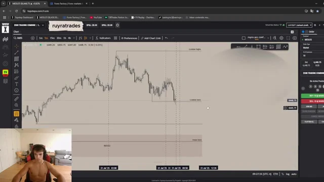
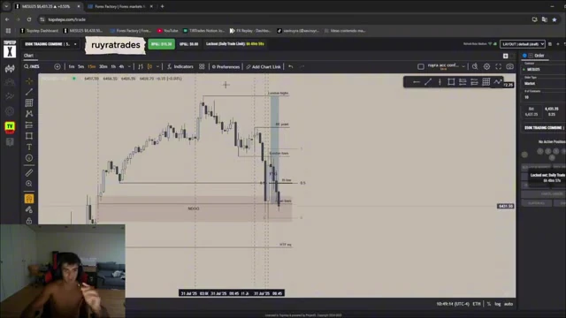
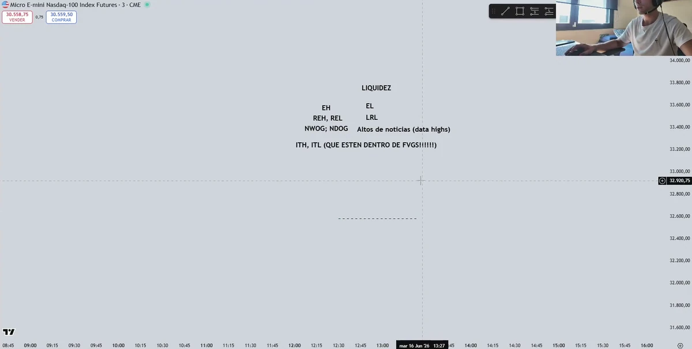

> **Confianza:** explícito · **Estado:** vigente · **Categoría:** SUPPORTING

## Definición

Gap de apertura semanal. Funcionalmente actúa como un FVG.

## Cómo identificarlo

Marcar el gap entre el cierre del viernes y la apertura del domingo/lunes.

## Errores comunes

No marcarlo; tratarlo como una simple línea.

### Requiere / se combina con

- [[fair-value-gap-fvg|Fair Value Gap (FVG)]]
- [[draw-on-liquidity-dol|Draw on Liquidity (DOL)]]

## Evidencia

- «Paráfrasis: NQ tapeó el FVG de 4H y ES no; SMT en 4H.» — `8gs6HOHXMsc` @ 05:20 (observado)
- «Paráfrasis: el NWOG actúa como un FVG.» — `u-fG6bYvK7k` @ 10:24 (explícito)

## Fragmentos visuales

**TRADE RECAP SP500 31/07/25 (''-800$'' TUVE SUERTE TENIENDO MALA SUERTE) TOPSTEP** (`YB4bOf9F3sk`) · **01:06** · **Confianza:** explícito · anotado
> ES1! 5m. Caja azul de sesión con etiquetas 'London highs', 'London lows' y 'Asian lows'. Rectángulo rojo 'NWOG' en la parte inferior. Líneas verticales punteadas de sesión. El precio sube, forma un máximo y empieza a baj…

**TRADE RECAP SP500 31/07/25 (''-800$'' TUVE SUERTE TENIENDO MALA SUERTE) TOPSTEP** (`YB4bOf9F3sk`) · **04:02** · **Confianza:** explícito · anotado
> ES1! 5m. Mismas etiquetas de sesión; el precio ha caído hasta la zona roja del NWOG/Asian lows. Línea 0.5. Precio corriente 6.412,25. Panel: cantidad 10, 'Locked out: Daily Trade 8h 47m 51s'.

**La SIMPLE ESTRATEGIA con la que he podido RETIRAR +25k$ en PAYOUTS** (`1C4dgloDQrY`) · **45:51** · **Confianza:** explícito · anotado
> La misma diapositiva 'LIQUIDEZ' completa: EH, REH, REL, EL, LRL, NWOG, NDOG, altos de noticias (data highs) e 'ITH, ITL (QUE ESTÉN DENTRO DE FVGS!!!!)'.

