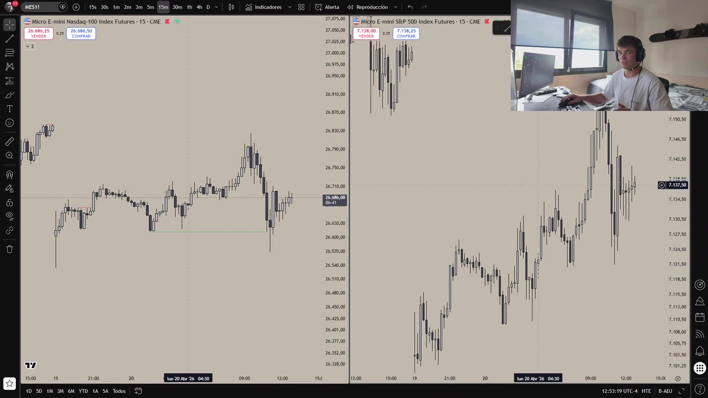

# NWOG (New Week Opening Gap)

> **Confianza:** explícito · **Estado:** vigente · **Categoría:** SUPPORTING

## Definición

Gap de apertura semanal. Funcionalmente actúa como un FVG.

## Interpretación de Xavi

Se respeta como un fair value gap; puede ser zona de reacción y target.

## Cómo identificarlo

Marcar el gap entre el cierre del viernes y la apertura del domingo/lunes.

## Cuándo se usa

Como zona de liquidez/imbalance y excepción al DOL.

## Condiciones

Mismas que un FVG.

## Temporalidades

4H/1H/15m/5m.

## Aplicación

Esperar respeto o relleno; usarlo como target.

## Errores comunes

No marcarlo; tratarlo como una simple línea.

## Excepciones

No siempre se rellena.

## Notas

Documento 02.

## Requiere / se combina con

- [[fair-value-gap-fvg|Fair Value Gap (FVG)]]
- [[draw-on-liquidity-dol|Draw on Liquidity (DOL)]]

## Evidencia

- «Paráfrasis: NQ tapeó el FVG de 4H y ES no; SMT en 4H.» — `8gs6HOHXMsc` @ 05:20 (observado)
- «Paráfrasis: el NWOG actúa como un FVG.» — `u-fG6bYvK7k` @ 10:24 (explícito)

## Fragmentos visuales

**TRADE RECAP SP500 31/07/25 (''-800$'' TUVE SUERTE TENIENDO MALA SUERTE) TOPSTEP** (`YB4bOf9F3sk`) · **01:06** · **Confianza:** explícito · anotado
> ES1! 5m. Caja azul de sesión con etiquetas 'London highs', 'London lows' y 'Asian lows'. Rectángulo rojo 'NWOG' en la parte inferior. Líneas verticales punteadas de sesión. El precio sube, forma un máximo y empieza a baj…

**TRADE RECAP SP500 31/07/25 (''-800$'' TUVE SUERTE TENIENDO MALA SUERTE) TOPSTEP** (`YB4bOf9F3sk`) · **04:02** · **Confianza:** explícito · anotado
> ES1! 5m. Mismas etiquetas de sesión; el precio ha caído hasta la zona roja del NWOG/Asian lows. Línea 0.5. Precio corriente 6.412,25. Panel: cantidad 10, 'Locked out: Daily Trade 8h 47m 51s'.

**Trade Recap 20/04/2026 (+1k$ y adivino todo lo que pasa)** (`xFKKj-ytJNI`) · **05:03** · **Confianza:** explícito · anotado
> NQ 5m. NWOG, FVG de 15m y estructura de largos.

