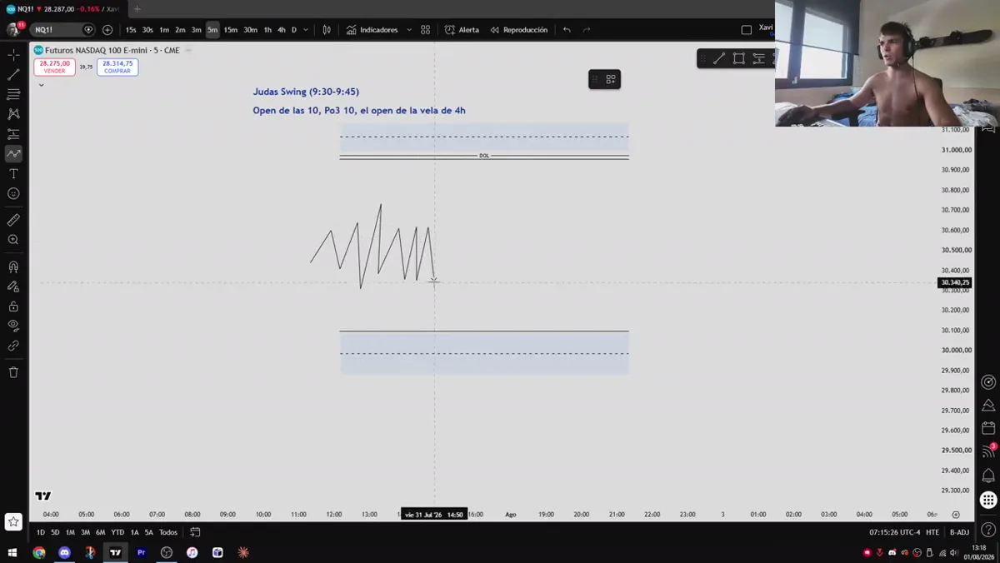
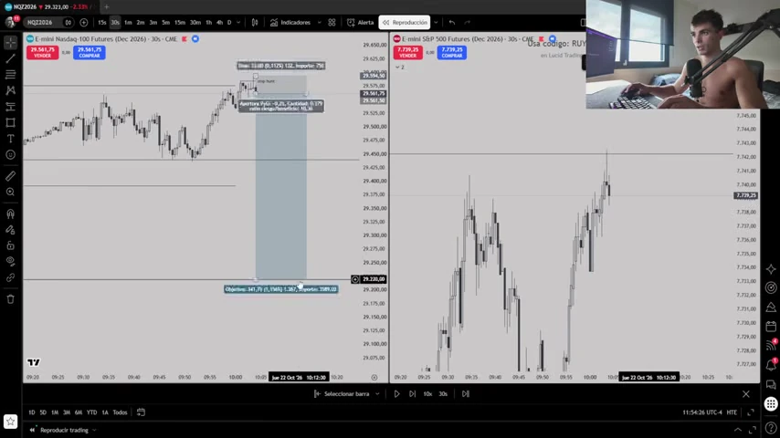
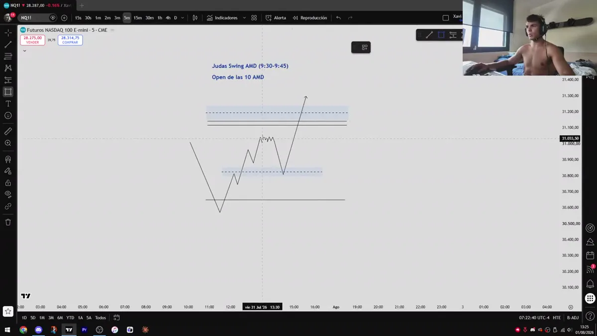

> **Confianza:** explícito · **Estado:** vigente · **Categoría:** CORE

## Definición

Apertura de la vela de las 10:00 NY, que coincide con el open de la vela de 4H y de 1H. Se busca un PO3 con liquidity sweep y entrada por IFVG/CISD.

## Interpretación de Xavi

Es el segundo sistema de entrada. Para largos quiere open low (manipulación abajo) y cierre alcista; para cortos, open high y cierre bajista. El open high/low solo cuenta si hay sweep.

## Cómo identificarlo

Acumulación antes de las 10:00; sweep de un high/low; open low/high en 1m; cierre en la dirección del DOL; IFVG/CISD.

## Cuándo se usa

10:00–10:30; a veces 10:15/10:30 como continuación.

## Condiciones

Liquidity sweep; zona de manipulación (gap de 5m o más); DOL claro; true manipulation.

## Temporalidades

1m para open high/low y entrada; 5m/15m/1H/4H para contexto y target.

## Aplicación

Esperar el sweep de las 10:00; entrar en el IFVG de 1m; stop al otro lado del sweep; target en gap/liquidez.

## Errores comunes

Entrar antes de las 10:00 (ej. 9:59:45); usar el color de la primera vela sin sweep; buscar la reversión completa; ignorar el correlacionado.

## Excepciones

No es mecánico; no todas las velas de las 10:00 abren al revés. Si el DOL ya se cumplió, no operar.

## Notas

Documento 05.

## Requiere / se combina con

- [[inverse-fair-value-gap-ifvg|Inverse Fair Value Gap (IFVG)]]
- [[po3-power-of-3|PO3 (Power of 3)]]
- [[amd-acumulacion-manipulacion-distribucion|AMD (Acumulación, Manipulación, Distribución)]]
- [[cisd-change-in-state-of-delivery|CISD (Change in State of Delivery)]]
- [[true-manipulation|True Manipulation]]
- [[nwog-new-week-opening-gap|NWOG (New Week Opening Gap)]]
- [[ndog-new-day-opening-gap|NDOG (New Day Opening Gap)]]

## Evidencia

- «Paráfrasis: las 10:00 son el open de la vela de 4H y de 1H.» — `vz4rhIi5Joo` @ 09:23 (explícito)
- «Si queréis buscar largos, tenéis que tener un open low... y un open high para buscar cortos.» — `vz4rhIi5Joo` @ 10:54 (explícito)

## Fragmentos visuales

**La MEJOR estrategia de ICT para FUTUROS (IFVG updated 2026)** (`vz4rhIi5Joo`) · **03:40** · **Confianza:** explícito · anotado
> Diapositiva sobre NQ 5m: 'Judas Swing (9:30-9:45)' y 'Open de las 10, PO3 10, el open de la vela de 4h'. Esquema de zigzag con dos zonas azules, una arriba y otra abajo.

**Trade Recap +15.000$ operando NQ (true manipulation + po3 explicado)** (`OdljBowQurk`) · **08:17** · **Confianza:** explícito · anotado
> Pantalla dividida NQ/ES en 30 segundos con la herramienta de posición larga: entrada 29.580,25, stop 29.576,25, objetivo 29.624,25 (RR 1:11). Zona de break-even marcada en 29.589,75, coincidiendo con gap de 5m y open de …

**La MEJOR estrategia de ICT para FUTUROS (IFVG updated 2026)** (`vz4rhIi5Joo`) · **10:55** · **Confianza:** explícito · anotado
> Diapositiva 'Judas Swing AMD (9:30-9:45)' y 'Open de las 10 AMD' con un zigzag que baja, acumula, manipula y distribuye al alza. Flecha de entrada tras la manipulación.

