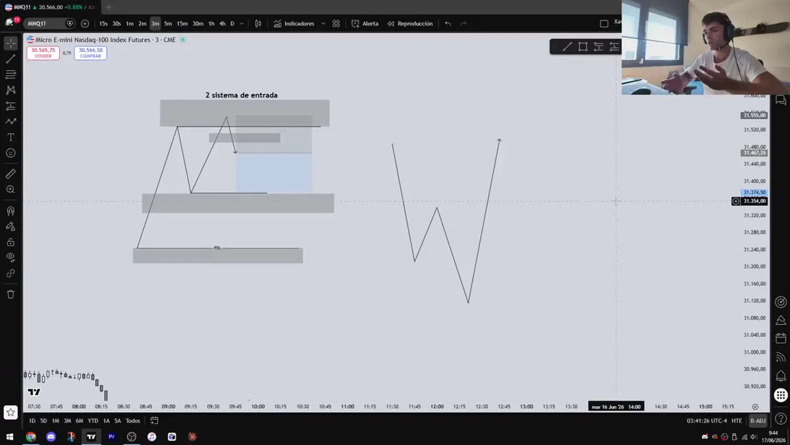

> **Confianza:** explícito · **Estado:** vigente · **Categoría:** SUPPORTING

## Definición

Trades que a simple vista cumplen la estrategia pero que, por el contexto (normalmente un desplazamiento agresivo previo), no son ideales y suelen acabar en stop.

## Cómo identificarlo

Mirar la forma y la velocidad del tramo previo: movimiento agresivo con pocos gaps = pattern trade; movimiento lento creando LRL = continuación fiable.

## Errores comunes

Entrar en el primer IFVG por miedo a perderse el movimiento.

### Requiere / se combina con

- [[inverse-fair-value-gap-ifvg|Inverse Fair Value Gap (IFVG)]]
- [[low-resistance-liquidity-lrl|Low Resistance Liquidity (LRL)]]
- [[displacement|Displacement]]

## Evidencia

- «Son trades que a simple vista parecen buenos, es decir, que cumplen con la estrategia, pero que por algún motivo no son ideales.» — `1C4dgloDQrY` @ 27:47 (explícito)

## Fragmentos visuales

**La SIMPLE ESTRATEGIA con la que he podido RETIRAR +25k$ en PAYOUTS** (`1C4dgloDQrY`) · **27:47** · **Confianza:** explícito · anotado · imagen de contexto, no muestra el concepto
> El mismo esquema '2 sistema de entrada', ahora con un recorrido en V dibujado a la derecha: el precio sube, gira y vuelve a subir. No hay etiquetas de 'pattern trade' en pantalla.

