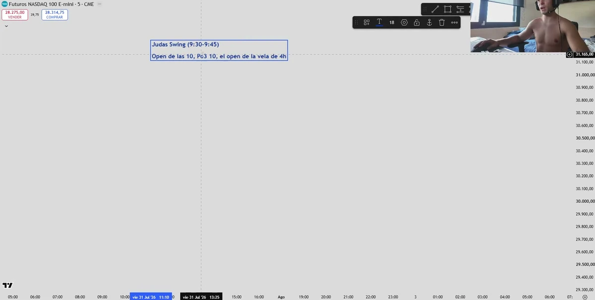
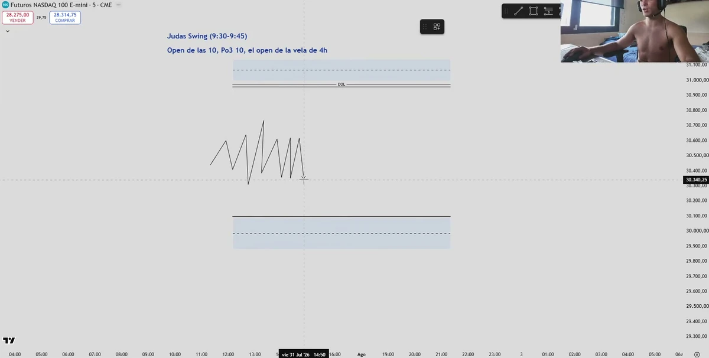

# PO3 (Power of 3)

> **Confianza:** explícito · **Estado:** vigente · **Categoría:** CORE

## Definición

AMD (acumulación, manipulación, distribución) acompañado de tiempo. Se busca en aperturas concretas, especialmente cada open de 15 minutos.

## Interpretación de Xavi

El PO3 no es un patrón de tres velas: es un ciclo temporal. La manipulación va hacia el lado opuesto del DOL; la distribución va hacia el DOL.

## Cómo identificarlo

En una apertura de 15m: acumulación previa; manipulación contra el DOL; distribución con desplazamiento. Para cortos, open high y close low; para largos, open low y close high.

## Cuándo se usa

En cada open de 15m, sobre todo 9:30, 9:45, 10:00, 10:15, 10:30.

## Condiciones

HTF PD array de 15m o más; equilibrium/descuento; DOL claro; LRL; estructura; timing.

## Temporalidades

15m para el ciclo; 1m/30s para la entrada.

## Aplicación

Esperar la manipulación; entrar en la distribución con IFVG/CISD; target en el DOL.

## Errores comunes

Entrar en la apertura sin esperar la manipulación; buscar PO3 sin HTF PD array; buscar PO3 alcista después de invertir el gap de 1H; entrar tarde.

## Excepciones

Si el primer PO3 falla, se estaquea; el PO3 puede darse en 10:15/10:30 como continuación.

## Notas

Documento 04.

## Requiere / se combina con

- [[inverse-fair-value-gap-ifvg|Inverse Fair Value Gap (IFVG)]]
- [[amd-acumulacion-manipulacion-distribucion|AMD (Acumulación, Manipulación, Distribución)]]
- [[judas-swing|Judas Swing]]
- [[open-de-las-10-00|Open de las 10:00]]
- [[cisd-change-in-state-of-delivery|CISD (Change in State of Delivery)]]

## Evidencia

- «Paráfrasis: PO3 significa AMD; es lo mismo, con atención al timing y a la hora en que ocurre.» — `vz4rhIi5Joo` @ 01:37 (explícito)
- «Paráfrasis: PO3 = AMD + tiempo; se puede dar en cada open de 15 minutos.» — `oP7enoxXpfI` @ 02:42 (explícito)

## Fragmentos visuales

**La MEJOR estrategia de ICT para FUTUROS (IFVG updated 2026)** (`vz4rhIi5Joo`) · **01:37** · **Confianza:** explícito · anotado
> Diapositiva con dos esquemas separados: 'Judas Swing (9:30–9:45)' y 'Open de las 10, PO3 10, el open de la vela de 4h'. No muestra las tres fases AMD rotuladas.

**La MEJOR estrategia de ICT para FUTUROS (IFVG updated 2026)** (`vz4rhIi5Joo`) · **03:40** · **Confianza:** explícito · anotado
> Diapositiva sobre NQ 5m: 'Judas Swing (9:30-9:45)' y 'Open de las 10, PO3 10, el open de la vela de 4h'. Esquema de zigzag con dos zonas azules, una arriba y otra abajo.

