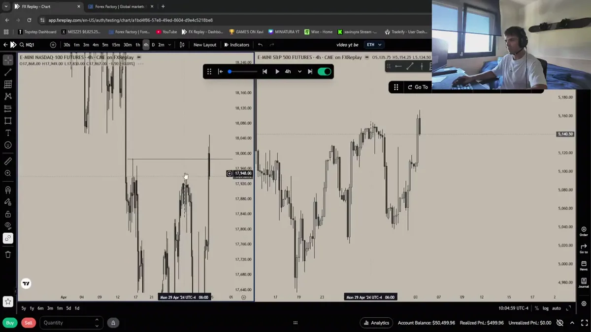

# Protected High / Low

> **Confianza:** observado · **Estado:** vigente · **Categoría:** SUPPORTING

## Definición

High/low que el precio no debería romper si la idea direccional es correcta; sirve de referencia para el stop y para la gestión.

## Interpretación de Xavi

Si el high/low protegido se rompe, la idea del trade deja de ser válida.

## Cómo identificarlo

Identificar el extremo que originó la manipulación o el último swing relevante.

## Cuándo se usa

Para gestionar el trade y decidir el stop.

## Condiciones

Contexto y estructura.

## Temporalidades

5m/15m/1H.

## Aplicación

Mantener el trade mientras el nivel se respete; si se rompe, salir.

## Errores comunes

Mover el stop más allá del nivel protegido; ignorar la ruptura.

## Excepciones

No está definido formalmente.

## Notas

Documento 07. Término usado en ejemplos, no definido como concepto.

## Requiere / se combina con

- [[fair-value-gap-fvg|Fair Value Gap (FVG)]]

## Evidencia

- «Paráfrasis: el high/low protegido marca el punto donde la idea deja de ser válida.» — `5aBdJLMDGJc` @ 06:22 (observado)

## Fragmentos visuales

**Aumenta tu WR entendiendo CUANDO y CUANDO NO ir BREAK-EVEN (sesión de backtesting 86% wr)** (`5aBdJLMDGJc`) · **06:22** · **Confianza:** observado · pendiente de anotación

