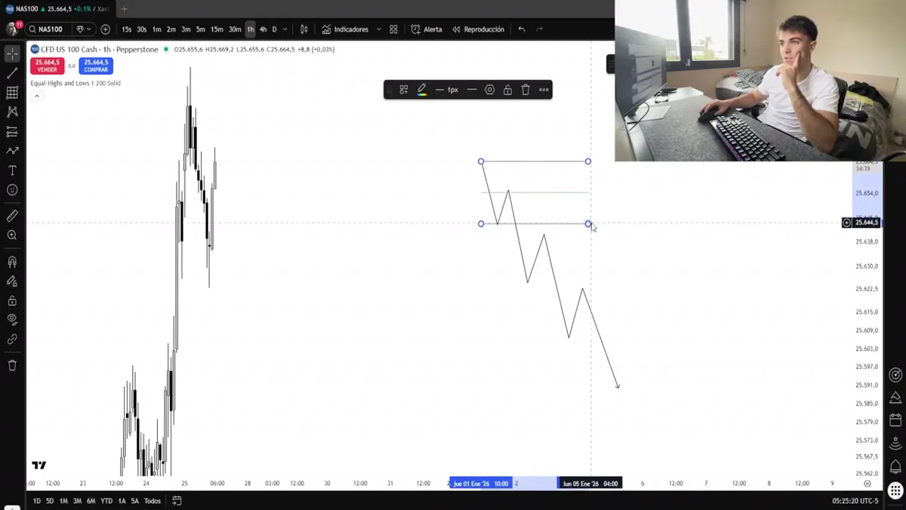
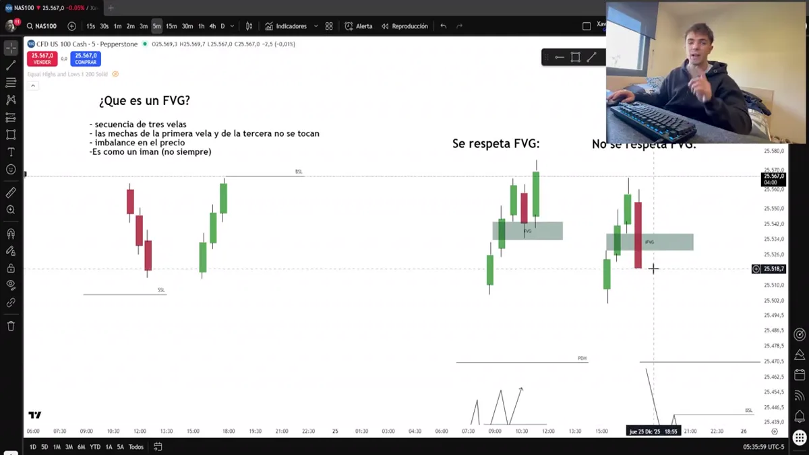
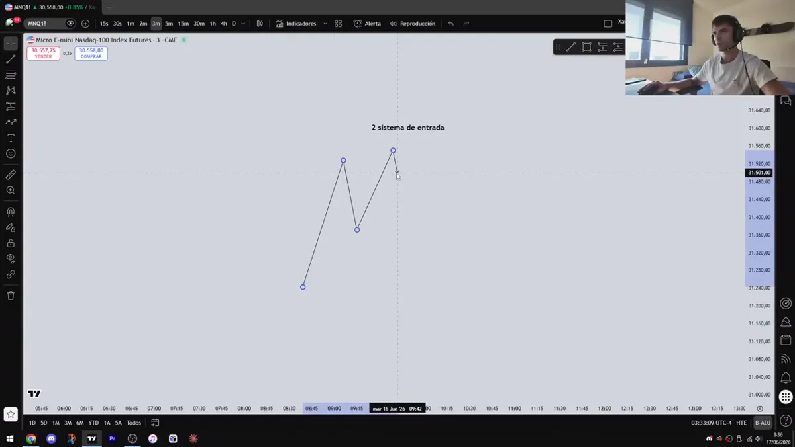

# RSI

> **Confianza:** observado · **Estado:** no usado · **Categoría:** NOT USED

## Definición

Indicador de fuerza relativa.

## Interpretación de Xavi

No aparece en su configuración ni en sus análisis.

## Cómo identificarlo

No aplica.

## Cuándo se usa

No usado.

## Condiciones

No aplica.

## Temporalidades

No aplica.

## Aplicación

No introducirlo en la enseñanza.

## Errores comunes

Añadirlo para 'completar' el análisis.

## Excepciones

Ninguna.

## Notas

Excluido por la regla del proyecto.

## Evidencia

- «No aparece en la configuración de TradingView del Día 2.» — `3aG0N7aHu4s` @  (observado)

## Fragmentos visuales

**COMO uso EQUILIBRIUM para TODAS mis ENTRIES** (`AacVWPPYK8Y`) · **05:27** · **Confianza:** observado · anotado
> Esquema dibujado a mano de una tendencia bajista: swing high, swing low y línea horizontal de equilibrium. Etiquetas de premium y descuento invertidas.

**SIN este CONCEPTO NUNCA serás RENTABLE | Como usar FVG's** (`u-fG6bYvK7k`) · **07:16** · **Confianza:** observado · anotado
> Diapositiva comparativa: 'Se respeta FVG' frente a 'No se respeta FVG', con dos mini-gráficos de tres velas y el FVG sombreado.

**La SIMPLE ESTRATEGIA con la que he podido RETIRAR +25k$ en PAYOUTS** (`1C4dgloDQrY`) · **19:30** · **Confianza:** observado · anotado
> Esquema dibujado sobre un gráfico NQ con el título '2 sistema de entrada'. Traza un recorrido en zigzag con puntos; no hay zonas de FVG visibles todavía.

