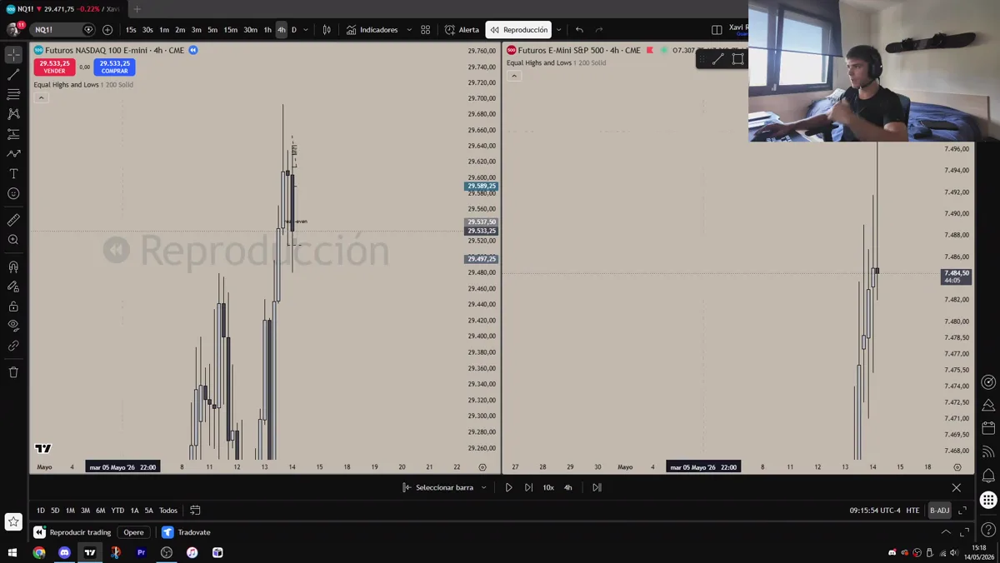
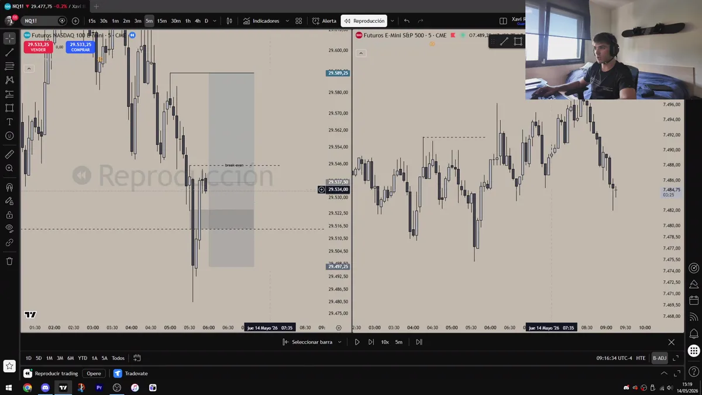
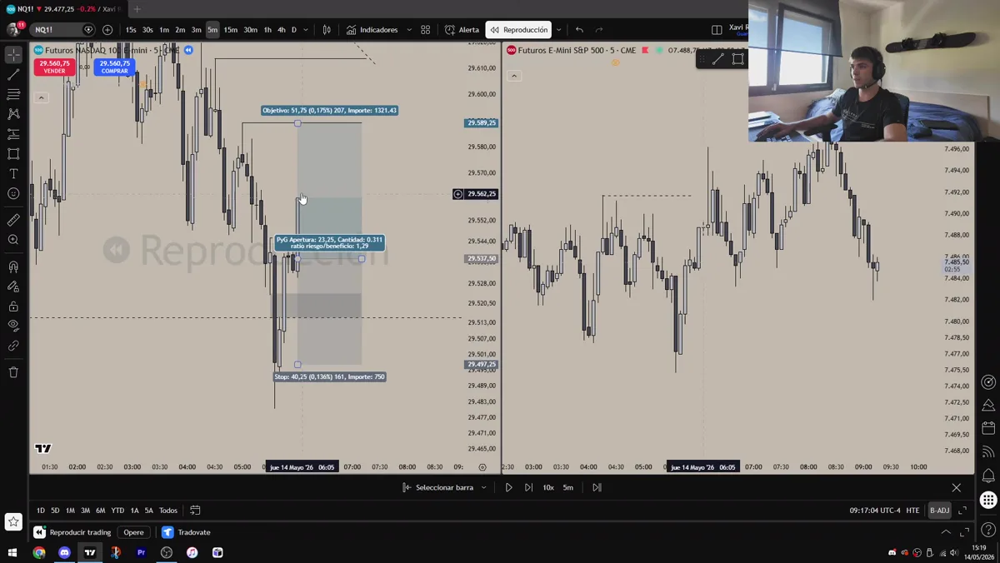

# Sesión de Londres

> **Confianza:** explícito · **Estado:** vigente · **Categoría:** CONTEXTUAL

## Definición

Sesión europea; Xavi la usa para pasar evaluaciones.

## Interpretación de Xavi

Pasa evaluaciones en Londres y opera fondeadas en Nueva York. No hay una explicación detallada de su metodología en Londres.

## Cómo identificarlo

Horario europeo.

## Cuándo se usa

Evaluaciones, si el trader ya tiene experiencia.

## Condiciones

Backtestear antes.

## Temporalidades

No documentado.

## Aplicación

Probar evaluaciones en Londres; no es la base del bootcamp.

## Errores comunes

Asumir que la metodología de NY se traslada sin probarla.

## Excepciones

No documentado.

## Notas

Documento 07. Vacío de investigación.

## Evidencia

- «Paráfrasis: en 4H el NQ había tapeado el FVG y el ES no; SMT como confirmación.» — `8gs6HOHXMsc` @ 03:00 (observado)
- «Paráfrasis: el long de Londres se apoya en muchos highs (LRL), una bajada lenta, resweep de 1H, FVG de 4H tapeado y ATH.» — `8gs6HOHXMsc` @ 03:40 (observado)
- «Paráfrasis: entrada long con stop y objetivo; ratio 1,29; break-even instantáneo.» — `8gs6HOHXMsc` @ 04:10 (observado)
- «La sesión de Londres básicamente es menos volátil, se mueve más lenta... el precio busca liquidez, se mueve a través de imbalances.» — `8gs6HOHXMsc` @ 06:17 (explícito)
- «Paráfrasis: las evaluaciones las pasa en Londres; las fondeadas las opera en Nueva York.» — `ndABd2MECBA` @ 07:54 (explícito)

## Fragmentos visuales

**Así he ganado +1000$ operando London Session (no podia dejar pasar este trade)** (`8gs6HOHXMsc`) · **03:00** · **Confianza:** explícito · anotado
> NQ 4H y ES 4H. FVG de 4H tapeado en NQ; highs/ATH y referencia de SMT.

**Así he ganado +1000$ operando London Session (no podia dejar pasar este trade)** (`8gs6HOHXMsc`) · **03:40** · **Confianza:** explícito · anotado
> NQ 5m y ES 5m. Zona gris de FVG, línea 'break-even' y highs marcados en ES. Contexto del long de Londres.

**Así he ganado +1000$ operando London Session (no podia dejar pasar este trade)** (`8gs6HOHXMsc`) · **04:10** · **Confianza:** explícito · anotado
> Herramienta de posición en NQ 5m: entrada, stop, objetivo y ratio riesgo/beneficio 1,29; zona de FVG.

