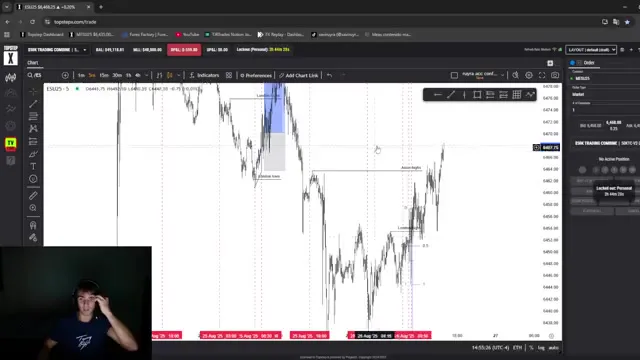
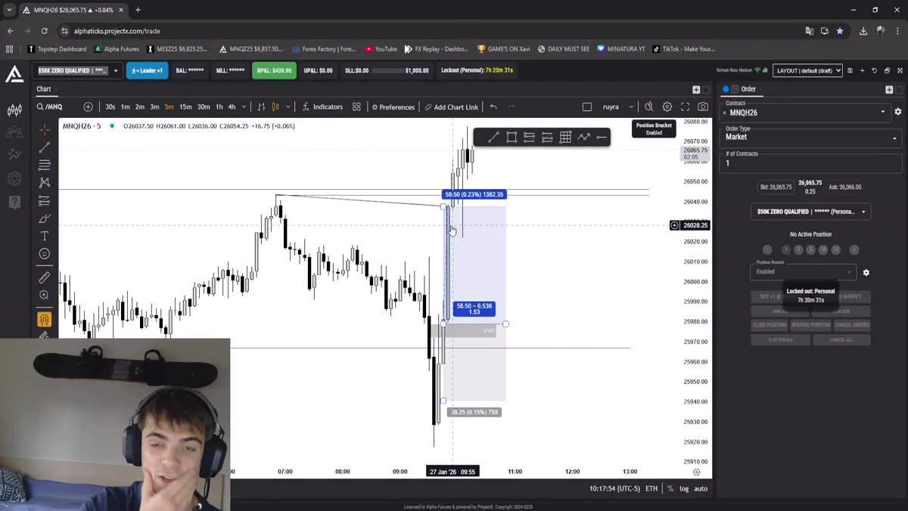
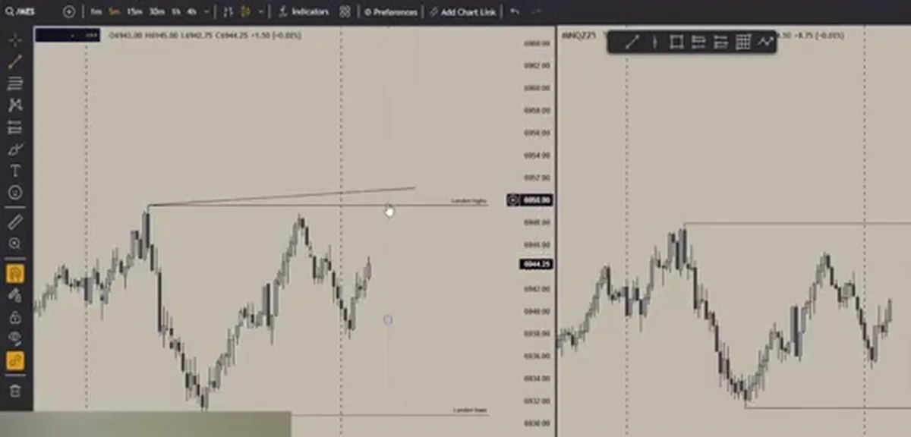

# SMT (Smart Money Technique)

> **Confianza:** explícito · **Estado:** vigente · **Categoría:** SUPPORTING

## Definición

Divergencia entre dos índices correlacionados: uno barre un high/low y el otro no.

## Interpretación de Xavi

No basta con la divergencia. El nivel barrido tiene que estar dentro de un FVG/PD array y ambos índices tienen que tener motivo para distribuir (true manipulation).

## Cómo identificarlo

Comparar NQ y ES en el mismo momento; ver si uno barrió el high/low y el otro no; comprobar si la zona barrida está dentro de un FVG.

## Cuándo se usa

Como confirmación o excepción al DOL.

## Condiciones

Nivel barrido dentro de FVG/PD array; true manipulation.

## Temporalidades

4H/1H/15m/5m.

## Aplicación

Confirmar un giro o una continuación; si no cumple, ignorar.

## Errores comunes

Usar cualquier divergencia; ignorar si el nivel está en una zona; no comprobar el segundo índice.

## Excepciones

Xavi dice que 'cuando tenemos doble SMT se cancela' (OdljBowQurk, 06:13), pero no identifica qué se cancela ni las condiciones; en junio describe dos SMT alineados con el dólar que refuerzan un corto (VE5H1qX50zA, 04:10–05:44). La relación entre ambos usos sigue abierta.

## Notas

Documento 03. Incluye un ejemplo de doble SMT como refuerzo en VE5H1qX50zA; no reconciliado con la frase de octubre.

## Requiere / se combina con

- [[draw-on-liquidity-dol|Draw on Liquidity (DOL)]]
- [[true-manipulation|True Manipulation]]

## Evidencia

- «Es una divergencia entre índices... normalmente en key levels.» — `sTS-iWJvTf0` @ 00:33 (explícito)
- «Super importante que siempre sea a la misma hora.» — `sTS-iWJvTf0` @ 02:08 (explícito)
- «Solo necesito que un índice toque mi zona de conflicto... voy a asumir que el Nasdaq ha tocado la misma zona.» — `sTS-iWJvTf0` @ 02:40 (explícito)
- «¿Son obligatorias las SMTs? No.» — `sTS-iWJvTf0` @ 03:11 (explícito)
- «SMT al canto, doble SMT alineado con el dólar.» — `VE5H1qX50zA` @ 04:41 (explícito)
- «Paráfrasis: si el SP500 barre un high/low que no está dentro de un FVG, el SMT no vale.» — `F3anMVV-VlI` @ 05:11 (explícito)

## Fragmentos visuales

**Así he perdido 450$ en dos días operando el SP500 (trade recap)** (`579RkuLzgPQ`) · **00:18** · **Confianza:** explícito · anotado
> MESZ25 5m. 'London highs', 'Asian highs' y zona FVG; panel 'Locked out'.

**Trade Recap 27/01/2026 (A+ day)** (`hisdBc9mGQ4`) · **00:39** · **Confianza:** explícito · anotado
> NQ 5m. FVG/equilibrium y entrada marcada; contexto A+.

**BIAS 29/10** (`FjOU3YeVW4E`) · **00:50** · **Confianza:** explícito · anotado
> Pantalla dividida ES (izquierda) y NQ (derecha), 5m. 'London high' y 'London low' en ES; estructura comparable en NQ.

