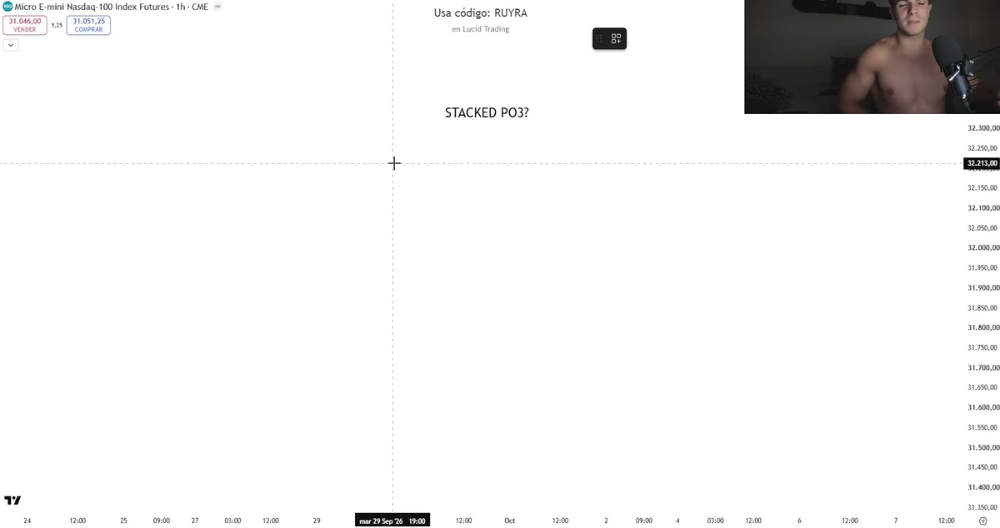
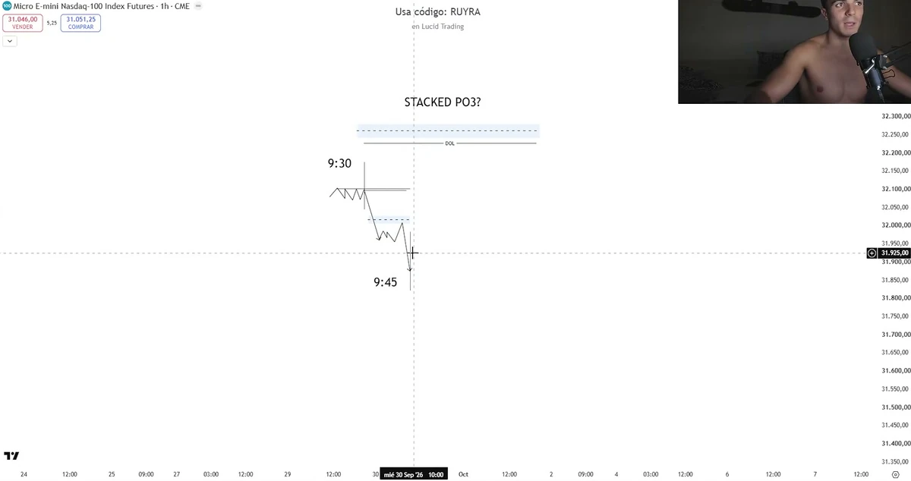

# Stacked PO3

> **Confianza:** explícito · **Estado:** vigente · **Categoría:** CORE

## Definición

Secuencia de PO3 en aperturas consecutivas de 15m (9:30 → 9:45 → 10:00 → 10:15 → 10:30) mientras se respetan los key levels.

## Interpretación de Xavi

Si el primer PO3 no distribuye, no se descarta el día: se espera al siguiente open. Cada nuevo high sin romper el primer nivel deja el precio en mejor descuento para cortos, siempre que haya estructura.

## Cómo identificarlo

Ver que el precio sigue manipulando sin romper el nivel clave; esperar el siguiente open de 15m.

## Cuándo se usa

Cuando el PO3 de las 9:30 o 9:45 no distribuye.

## Condiciones

Key levels respetados; DOL vigente; estructura (LRL, equal lows, subida lenta).

## Temporalidades

15m.

## Aplicación

Esperar la distribución en 9:45, 10:00, 10:15 o 10:30; entrar con IFVG/CISD.

## Errores comunes

Abandonar el día tras el primer PO3 fallido; estaquear sin estructura; shortear una subida vertical.

## Excepciones

Si se invierte el gap de 1H, no se busca PO3 alcista.

## Notas

Documento 04.

## Requiere / se combina con

- [[po3-power-of-3|PO3 (Power of 3)]]
- [[amd-acumulacion-manipulacion-distribucion|AMD (Acumulación, Manipulación, Distribución)]]
- [[equal-highs-equal-lows|Equal Highs / Equal Lows]]
- [[low-resistance-liquidity-lrl|Low Resistance Liquidity (LRL)]]

## Evidencia

- «Paráfrasis: si no se da en 9:30, esperar 9:45; si no, 10:00; y así continuamente.» — `oP7enoxXpfI` @ 06:17 (explícito)
- «Paráfrasis: en el ejemplo, tras el primer intento de 9:30, la apertura de 9:45 puede manipular y continuar; si falla, puede abrirse otro escenario.» — `oP7enoxXpfI` @ 08:52 (explícito)

## Fragmentos visuales

**Stacked PO3 + Backtesting (la mejor manera de traderar ICT)** (`oP7enoxXpfI`) · **06:18** · **Confianza:** explícito · anotado
> Diapositiva 'STACKED PO3?' sobre un gráfico NQ 1H vacío.

**Stacked PO3 + Backtesting (la mejor manera de traderar ICT)** (`oP7enoxXpfI`) · **08:52** · **Confianza:** explícito · anotado
> Esquema dibujado sobre NQ 1H: zigzag con etiquetas 9:30 y 9:45 y una zona azul superior (BSL). El primer intento de las 9:30 falla y el segundo de las 9:45 continúa.

