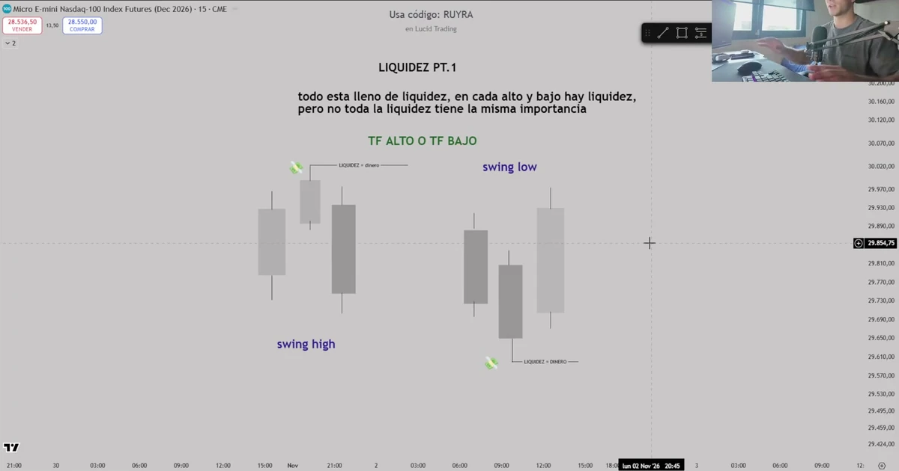
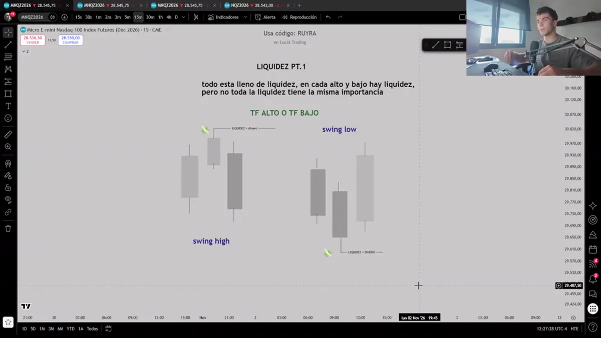

# Swing High / Swing Low

> **Confianza:** explícito · **Estado:** vigente · **Categoría:** CORE
- **Clases del bootcamp:** [[../bootcamp/dia-04|Día 4]] · [[../bootcamp/dia-06|Día 6]]

## Definición

Máximo o mínimo prominente en los extremos de un rango. En el Día 4: un high se forma con una vela alcista seguida de una bajista; se marca la mecha más alta de las dos. Un low se forma con una vela bajista seguida de una alcista; se marca la mecha más baja.

## Interpretación de Xavi

Son los puntos que generan liquidez. Para liquidez se marca la mecha extrema, no el cuerpo.

## Cómo identificarlo

Secuencia de dos velas: alcista→bajista para high; bajista→alcista para low. Dos velas del mismo color no forman ni high ni low.

## Cuándo se usa

Para marcar BSL/SSL, estructura y targets.

## Condiciones

La temporalidad importa: un swing de 4H pesa más que uno de 1m.

## Temporalidades

Todas; HTF para contexto, LTF para ejecución.

## Aplicación

Marcar los extremos del rango y usarlos como referencia de liquidez.

## Errores comunes

Usar el cuerpo en lugar de la mecha para liquidez; marcar dos velas del mismo color como high/low; ignorar la temporalidad.

## Excepciones

Si la temporalidad no forma un low válido, bajar de temporalidad para encontrar la mecha extrema.

## Notas

Bootcamp Día 4. La definición de high/low se usa también para estructura.

## Requiere / se combina con

- [[draw-on-liquidity-dol|Draw on Liquidity (DOL)]]
- [[equal-highs-equal-lows|Equal Highs / Equal Lows]]

## Evidencia

- «Paráfrasis: high = vela alcista seguida de bajista, se marca la mecha más alta; low = bajista seguida de alcista, la mecha más baja.» — `SuRgJd8ONIc` @  (explícito)
- «Paráfrasis: los altos y bajos importantes que despuntan en los extremos del gráfico son swing highs/lows; la imagen los representa como liquidez en ambos extremos.» — `7HOAf7vHMqU` @ 02:43 (explícito)
- «Paráfrasis: high = vela alcista seguida de bajista, se marca la mecha más alta; low = bajista seguida de alcista, la mecha más baja.» — `SuRgJd8ONIc` @ 15:12 (explícito)

## Fragmentos visuales

**Bootcamp Día 6: Liquidez pt1** (`7HOAf7vHMqU`) · **01:08** · **Confianza:** explícito · anotado
> Diapositiva 'LIQUIDEZ PT.1' superpuesta a un gráfico MNQ 15m. Texto: 'todo está lleno de liquidez, en cada alto y bajo hay liquidez, pero no toda la liquidez tiene la misma importancia'. Anotaciones 'swing high' y 'swing…

**Bootcamp Día 6: Liquidez pt1** (`7HOAf7vHMqU`) · **02:43** · **Confianza:** explícito · anotado
> Gráfico MNQ 15m con un rango amplio. Línea horizontal y etiqueta 'LIQUIDEZ = DINERO' sobre el swing high; otra sobre el swing low. Texto 'TF ALTO O TF BAJO'.

