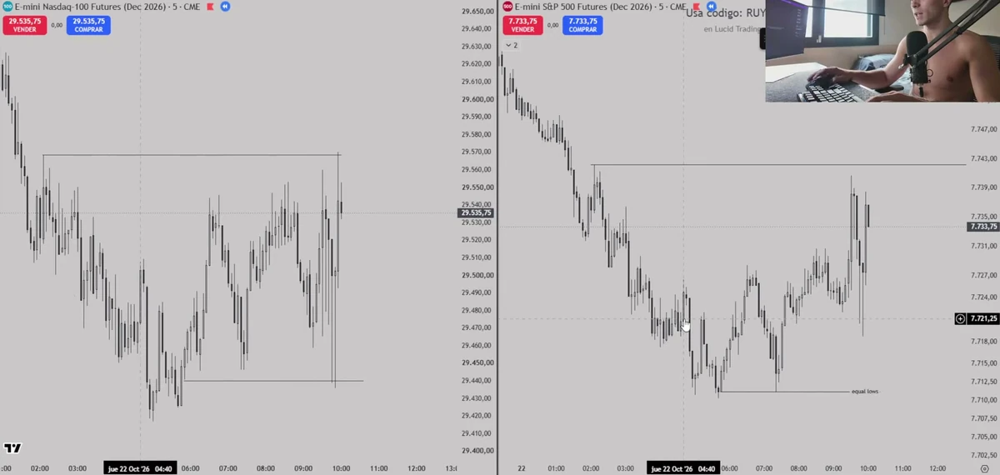

> **Confianza:** explícito · **Estado:** vigente · **Categoría:** CORE
- **Clase del bootcamp:** [[../bootcamp/dia-17|Día 17 — SMT's y True Manipulation]]

## Definición

Situación en la que los dos índices correlacionados (NQ y ES) están en un punto donde tiene sentido que distribuyan.

## Cómo identificarlo

Comprobar que el NQ y el ES han tocado sus zonas relevantes (FVG/PD array) o que ambos tienen liquidez que justifica la distribución.

## Errores comunes

Validar un SMT porque un índice barrió un high/low sin comprobar el otro; confundir divergencia con true manipulation.

### Requiere / se combina con

- [[draw-on-liquidity-dol|Draw on Liquidity (DOL)]]
- [[po3-power-of-3|PO3 (Power of 3)]]
- [[smt-smart-money-technique|SMT (Smart Money Technique)]]

## Evidencia

- «La true manipulation es cuando los dos índices están listos para distribuir.» — `OdljBowQurk` @ 04:40 (explícito)
- «Cuando tenemos doble SMT se cancela.» — `OdljBowQurk` @ 05:42 (explícito)
- «Acaba de tocar el gap de 4 horas. True manipulation. Ahora podemos bajar.» — `OdljBowQurk` @ 07:35 (explícito)
- «Los dos índices tienen que estar en un spot de distribución.» — `sTS-iWJvTf0` @ 10:04 (explícito)
- «Cuando uno de los dos haya tocado un key level y cuando el otro esté mínimo en un fair value gap de 5 minutos o superior.» — `sTS-iWJvTf0` @ 13:12 (explícito)

## Fragmentos visuales

**Trade Recap +15.000$ operando NQ (true manipulation + po3 explicado)** (`OdljBowQurk`) · **04:41** · **Confianza:** explícito · anotado · imagen de contexto, no muestra el concepto
> Pantalla dividida NQ/ES en 5m. Rectángulos grises marcan los gaps de 4H y 5m; el precio los atraviesa y luego invierte.

