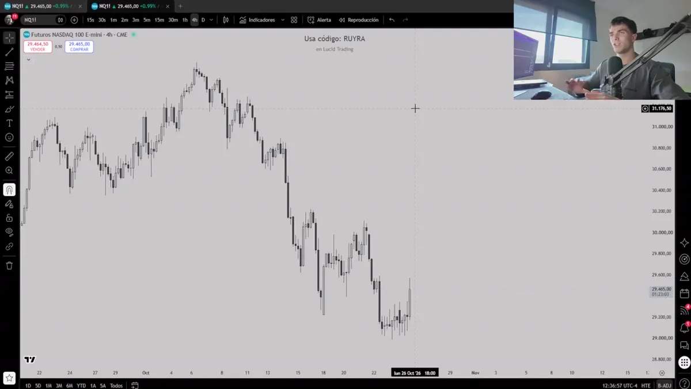

# Volumen

> **Confianza:** explícito · **Estado:** no usado · **Categoría:** NOT USED

## Definición

Indicador de volumen.

## Interpretación de Xavi

Lo elimina explícitamente de TradingView en el Día 2.

## Cómo identificarlo

No aplica.

## Cuándo se usa

No usado.

## Condiciones

No aplica.

## Temporalidades

No aplica.

## Aplicación

No introducirlo.

## Errores comunes

Usarlo para confirmar.

## Excepciones

Ninguna.

## Notas

Bootcamp Día 2.

## Evidencia

- «Paráfrasis: quitar el volumen de TradingView.» — `3aG0N7aHu4s` @  (explícito)

## Fragmentos visuales

**Bootcamp Día 2: Preparación (configuras TradingView)** (`3aG0N7aHu4s`) · **04:44** · **Confianza:** explícito · anotado
> Gráfico NQ 4H con velas gris claro y negro, mechas y bordes negros, fondo CAC8C8. Sin volumen ni indicadores.

